# MangoLeaf AI Architecture

## Recovery-code-first private backup candidate (October 25, 2026)

Both Android variants now keep SQLite reports and private photo files local until explicit recovery-code setup. Ordinary startup, saving and reconnecting do not initialize a private Supabase client, enroll a new owner or upload reports before a code exists. Public guideline HTTP/Realtime behavior remains independent. A deliberate create request establishes verified, quota-limited ownership using the existing provisioning function, attaches credentials to the same existing Auth UUID when present, persists the candidate session/code/enablement together and starts foreground/online backup only after that commit. There is no saved-code confirmation checkbox. New code creation is explicit enablement and supersedes an earlier pause on an installation without a code. Failed setup preserves prior settings and does not enable uploads.

Existing code users retain enabled state or deliberate pauses, including legacy `false`; an older anonymous owner without a code remains preserved for later attachment and scoped deletion work while uploads are off. Explicit restore with a verified existing code enables a fresh device without overriding a deliberate pause. The UI exposes local-only status and creation before setup, then code access and Pause/Resume. It distinguishes enabled backup from completed uploads. Reopening/reconnection retries unfinished reports; completed immutable copies are skipped, and an interrupted photo can restart. Restore merges owned complete reports by ID and respects local deletion records. A saved-code reconnect can recover an unavailable session; after server verification, only a candidate for that same vault may drain its pending deletions before local session promotion. A different vault cannot consume those jobs.

The existing private `scans` Storage bucket, `public.scans`, `android_backup_reports`, Auth/RLS, deletion outbox and paired transfer functions remain the protocol. Pending deletion continues independently of upload enablement; no cross-device deletion propagation or historical cleanup is added. Production and Debug remain pinned to production/testing respectively. This is an unpublished source change with affected validation pending; older installed bundles retain their earlier behavior until updated. The dated sections below preserve their original scope.

## Native branding and APK delivery (October 24, 2026)

The Java host prepares native v0.1.6/code 7 with the same white-backed adaptive leaf for application, round/package and launcher Activity icons. The temporary plain-package-leaf resource is removed: it made Package Installer show only a bare leaf and did not remove the reported My Files border. Existing launcher layers and the separate transparent system-startup leaf are unchanged. Default bundles target 7-7; SQLite/bridge remain 1/1. Samsung/OEM consumers can style icons after loading them; raw APK resource tests do not establish their final thumbnails. Published v0.10.0 / APK 0.1.5/code 6 remains immutable.

For the pinned production website origin, the verified release tag selects a same-origin `/apk/<tag>/mangoleaf-ai.apk` attachment. Root `vercel.json` proxies only the fixed repository APK path; no API function, private token or APK under `public/` is introduced. Other origins retain GitHub links. APK and latest-release requests bypass service-worker caching; the page also links the exact release. This is a mitigation for the observed GitHub/Brave handoff, not a verified browser root-cause fix. The maintainer reported successful production phone downloads; this does not establish every browser or transfer edge case. Vercel serves the APK bytes and its normal transfer accounting applies. [External rewrite behavior](https://vercel.com/docs/routing/rewrites) is independent of Supabase backup.

## Browser landing boundary (October 24, 2026)

Since v0.10.0, the application routes by the compiled Android build target, never by viewport or user agent. `src/app/page.tsx` mounts `BrowserLanding` for every website browser, including development. Only an Android bundle loads the separate `Application` component with model initialization, scan/storage hooks, diagnostics and the backup worker. An Android build without the trusted native bridge still fails closed.

Browser Home reuses the existing explanatory cards and download prompt; About exposes Android installation actions without diagnostics or recovery panels. Below 768px, the website centers its leaf/name header and provides a fixed Home, About, open/install and language bottom bar without Scan or History. Production and development phone language controls show only the current EN or BIS code. At 768px and above, the existing header navigation remains. The APK supplies Diagnostics and recovery as children of the shared About view, importing both with its application entry so first navigation cannot suspend the entire application; the website imports neither panel. The floating Next development indicator is disabled because its default lower-left placement covers Home on narrow screens; development errors still surface. Desktop QR links and `?install=1` guide behavior are preserved. No website History database is opened or migrated by this entry point, and private browser backup is disabled even in development. Dexie compatibility code and stored records remain for preservation and regression coverage. APK storage and cloud routing are unchanged.

**Current source candidate:** shared web `0.11.0`, native `0.1.7`/code `8`, bounds `8-8`, adopted model `v4.5.0`; unpublished. GitHub v0.10.1 is published; the new recovery-code-first candidate does not replace its existing assets. Bridge/SQLite schema remain 1/1. Local runtime model assets/configuration/constants now match the committed adopted V4.5.0 baseline. V5 research records remain preserved; the browser worker retires the old V5 model runtime cache without clearing History or photos.

`useGuidedCamera` copies the original centered square before stopping its stream. `camera-image.ts` transfers that bitmap to a short-lived `camera-image-worker.ts` worker for JPEG quality 0.92 encoding, avoiding Chromium's main-thread idle encoder. A five-second timer or worker error terminates it and uses synchronous same-frame JPEG encoding; unsupported workers use that compatibility path directly. Cancel/background terminates pending encoding and closes late bitmaps without publishing stale photos. The fallback briefly occupies the main thread, and timers are not hard wall-clock guarantees under blocked scheduling. The result-details modal loads with `Application`, avoiding a second root splash on the first result; the website still excludes the entire scanner entry. No model preprocessing, crop, storage or cloud protocol changes accompany this patch.

Native APK versions, signing/builds, compatibility and release rules now live in [Android APK versioning](versions/ANDROID_APK_VERSIONING.md). The [Android APK history](versions/history/ANDROID_APK_HISTORY.md) preserves the earlier combined implementation guide and its section bookmarks. The native `android/` project and the application footer are unchanged by this documentation move.

## Storage and lifecycle audit (October 23, 2026)

**Version-display follow-up:** `useAndroidVersion` reuses the trusted native `app.info` initialization and validates its optional `hostVersionName`. APK footers pair that installed version with the active model; About retains the web-bundle version. Browser footers stay app/model-only. `android-version.mjs` shares a side-effect-free parser/label formatter between browser and Node release tools. The download page reads an optional production version from the already-validated APK asset's publisher label, independently of its GitHub release tag. Missing/invalid labels never invent a native version or authorize a download. No new native API, network endpoint, environment variable or database resource is introduced.

`useStorageQuery` delegates native observation to `storage-query.ts`: one active query, one coalesced replay, stale-publication suppression and unsubscribe cleanup. `native-storage.ts` shares History reads, retries if its storage revision changes, hydrates four photos concurrently and bounds immutable-photo reuse to 64 entries/16 MiB. An unreadable photo leaves usable metadata; backup reads still fail closed. This cache does not paginate the full History result.

`cloud-history-delete.ts` serializes only scope-sensitive local commits. Recovery Auth candidates use isolated in-memory storage and server verification before a short local promotion; retired session adapters reject stale refresh writes. Network verification and old-owner deletion drains happen outside that guard. Uploads recheck foreground/busy/pause between reports and re-read a report after first-owner enrollment. `backup-recovery-form.tsx` owns presentation/focus callbacks; `backup-recovery-panel.tsx` retains operation and session state with synchronous duplicate-action and stale-preference guards.

Native OTA restart verification captures state under short locks, verifies outside locks and commits only after the Activity rechecks current foreground/camera/picker/busy state and the exact pending candidate. Cancellation keeps task ownership through cleanup. An unacknowledged OTA renderer crash invalidates only the cached selection so durable cold-launch rollback can run. These native changes require **0.1.4/code 5**, default host range **5-5**; bridge/schema and stored reports remain unchanged. See [audit evidence](testing/ANDROID_TESTING.md#october-23-2026-implementation-audit).

## Website launch and installation hints (October 22, 2026)

`android-installation.ts` and `useAndroidAppLink` share bounded, short-lived positive-only related-app hints. `android-install-action.tsx` keeps the original user tap on a fixed package intent and provides a synchronous guide fallback. Header, download prompt and desktop About actions share this behavior. `/download` puts repeat downloads behind an explicit choice when installed. The web manifest and Release-only native `asset_statements` link the exact production package/website; Debug has no production association. This is presentation metadata, never native bridge or Auth authorization. New native metadata needs 0.1.3/code 4 and default bundle host bounds 4-4; bridge/schema and storage remain unchanged. See [behavior and release requirements](versions/ANDROID_APK_VERSIONING.md#website-open-or-install).

## Automatic native backup and verified update offers (October 22, 2026)

Production now uses lazy anonymous Auth and quota-limited enrollment, scoped to its verified native host/project. Development browser and Debug remain testing-only. Recovery creation keeps the same owner; restore remains an explicit merge. Pause/Resume preserves explicit pauses. No SQL/RLS/provider changes accompany this follow-up.

`android-update.ts` observes verified native status while foreground and idle. `android-update-modal.tsx` replaces the About update card. Guarded `ota.restart` releases process-owned selection only after native writes settle, then recreates the trusted local Activity; ordinary recreation retains selection. Host 0.1.2/code 3 and default bundle bounds 3-3 gate the method. Debug retains its production-OTA block. See [current behavior and release channels](versions/history/ANDROID_APK_HISTORY.md#automatic-production-backup-and-update-prompt-october-22-2026). Earlier dated sections describe preceding candidates.

## Production APK and release assets (October 22, 2026)

Release builds use external permanent signing material, pinned production Supabase settings and committed model inputs. `tools/android-release.ps1` temporarily unlocks CurrentUser DPAPI credentials on Windows; `android-release.mjs` keeps secrets out of web/SDK children, validates the signing configuration, builds/lints, and verifies the signed package. Gradle's `verifyReleaseBundle` and independent APK inspection bind a local receipt to actual signed web/model files and `production-trust.json`. Debug has a separate package/testing target and always disables production OTA trust. SQLite/photos/recovery credentials remain outside replaceable bundles.

`android-ota-release.mjs` verifies the installed host's signed identity, builds a production Android export, enforces pinned model/bridge/schema/host compatibility and signs/verifies an unpublished OTA candidate. The operator must choose a sequence higher than every published update, including rollback. A stable latest GitHub Release needs `mangoleaf-ai.apk`, `web-update.zip`, `update.json` and `update.sig`; preparation never publishes them. The website's download screen makes one bounded public metadata request and exposes the APK only after strict repository/tag/asset validation. It preserves an honest unavailable state when verification fails and retains explicit installed-app opening.

Production cloud setup was deployed after exact existing owner/path policy preflight and private preservation snapshots. New backup resources and the provisioning function are installed; the maintainer enabled its explicit server flag. Nine catalog checks and safe HTTP checks passed, with all original scans, guidelines, Auth users, photo metadata, policies and grants unchanged. Production app backup remains opt-in; no automated production identity/scan/photo was created. See [current deployment evidence](versions/history/ANDROID_APK_HISTORY.md#production-cloud-deployment-status-october-22-2026) and [production security review](security/SECURITY-AND-SYNC.md#production-release-preparation-october-22-2026). Earlier dated pending-rollout statements below retain their original scope.

## Camera permission lifecycle and website app opening (October 21, 2026)

Native camera permission prompts temporarily pause the activity without a true app stop. `MainActivity` keeps WebView visible during that pending prompt so `useGuidedCamera` can finish its original `getUserMedia` request; actual `onStop`, closure and permission denial still release/cancel work. After a frame is copied, the camera hook releases tracks before encoding the fixed square JPEG and clears its canvas after settlement. The cancellation token remains valid until completion unless the user closes/backgrounds the camera. Optional diagnostics distinguish frame copying, JPEG encoding and final handoff without logging content.

`useAndroidAppLink.ts` provides Android-browser installation/download UI with a user-initiated, package-pinned Chrome intent and same-origin information-page fallback. Development opens the separate debug package; published sites target release. No package presence is inferred. The native `mangoleaf://open` entry brings a single existing activity forward and ignores URI data/extras rather than navigating trusted content. This requires an updated native APK, adds no remote backend and preserves separate browser/debug/release storage. See [native behavior and limits](versions/history/ANDROID_APK_HISTORY.md#camera-permission-capture-and-installed-app-opening-october-21-2026).

## Automatic testing ownership and recovery (October 21, 2026)

The latest testing path requires the pinned testing URL, testing environment and either verified Android host or browser development mode. An eligible saved JPEG/WebP report lazily starts real Supabase anonymous Auth. The testing Edge Function verifies the bearer with Auth, applies its existing provisioning quota and marks the same owner through protected `app_metadata`; the client refreshes its claims before using existing owner/path RLS and transfer RPCs. Existing credentialed owners are reused. Public guidelines and local saving never wait for this setup. Production still requires explicit recovery-code consent and does not create anonymous guests automatically.

Creating a code attaches recovery credentials to the same testing Auth UUID, preserving its uploaded records. Connecting another code verifies it in an isolated client before replacing the persisted session; wrong credentials preserve the current owner. Confirmed deletion jobs must settle before an owner switch. A project-scoped public owner label routes deletion jobs before a code exists, while server Auth remains the authorization boundary. Existing code-based scopes and native deletion records remain compatible. Cross-device deletion propagation is intentionally absent: another device retaining a stale local report can upload it again.

The APK recovery panel supports create, show/hide, copy, focused entry, clear-input and restore. Clearing input does not erase credentials or reports; restore merges by record ID and preserves original dates. The report archive UI and browser archive modules are retired; bounded legacy native methods remain for compatible older bundles and cloud recovery's internal import. Stored browser/native History is preserved. The native manifest requests portrait orientation on phones; browser orientation is unchanged. See [current recovery setup and limits](versions/history/ANDROID_APK_HISTORY.md#automatic-testing-backup-and-recovery-october-21-2026). Earlier dated sections describe their original implementation stage.

## Android system-bar layout (October 21, 2026)

`MainActivity` enables AndroidX edge-to-edge layout and places its WebView inside an inset-aware native `FrameLayout`. System bars, display cutouts and keyboard space shrink the actual child viewport; sticky/fixed web controls therefore remain inside the usable screen. The container consumes those insets instead of passing them into WebView/CSS for a second application. Native startup failures use the same container. This replaces ineffective padding on the WebView itself and requires a rebuilt APK, with no React layout, storage, model or bridge changes. See [native layout and checks](versions/history/ANDROID_APK_HISTORY.md#system-bars-and-web-viewport-october-21-2026).

## Synchronized History deletion (October 21, 2026)

`local-scans.ts` delegates confirmed deletion to `cloud-history-delete.ts`. Browser development atomically records a project/vault-scoped outbox job and deletes the local report/photo in Dexie v10. Native host `0.1.1-dev`/code `2` commits the job in existing SQLite settings alongside local removal and its permanent anti-resurrection record; SQLite/bridge versions remain 1. The browser production compatibility path remains local-only. Existing reports, metadata and hidden legacy tombstones are preserved by the additive browser store upgrade.

`cloud-backup.ts` drains current-vault deletions before uploads and again after settling uploads. It processes bounded batches, validates the server Auth identity against the connected recovery code, reads only owned manifests, removes the private object via Storage, and invokes the existing transactional paired-row delete. Jobs survive failure, offline operation and restart; acknowledgment follows real completion. Pausing uploads does not pause an already confirmed deletion. Switching vaults never transfers pending jobs. Restore drains the connected vault's queue first. Diagnosis, local saving and public advice remain independent.

This changes future confirmed History deletions, not historical cloud cleanup. Existing absent reports/tombstones are never converted into remote deletion jobs. Other devices with stale copies can still reupload; pause other writers. Current Auth/RLS and recovery-code sign-in remain in use; merely calling anonymous sign-in would not satisfy the backup-vault ownership guard. See [native/cloud preservation and rollback](versions/history/ANDROID_APK_HISTORY.md#history-deletion-and-recovery-october-21-2026).

## Android-only mobile platform (October 21, 2026)

The mobile product targets Android APK only. One Android installation guide is used on every screen, with a desktop QR and a link to APK availability information. iPhone/iPad steps, browser PWA install controls and Apple web-app metadata are removed. `useInstallGuide.ts` consumes the QR flag, suppresses browser install prompts, and manages dialog focus; it does not infer APK installation from a user agent or a legacy standalone website. `usePWAInstall.ts` is retired. Desktop website access, browser development scanning and existing Dexie History/export remain available. The footer labels the shared application bundle as App; native host and model versions remain separate.

Current automated browser projects are Chromium desktop, Chromium Android emulation and Firefox desktop. The iPhone WebKit project is retired; browser-engine diagnostics and dated historical platform evidence are preserved without implying mobile support. Android physical-device APK checks remain separate from browser automation.

## Development cloud routing (October 21, 2026)

`cloud-target.ts` pins separate testing/production project identities. `next.config.ts` reads ignored `.env.testing.local` explicitly for browser development; the Android builder selects testing by default and production with `--release`. Both public-key aliases are normalized so inherited `.env.local` values cannot redirect a debug build. Backend selection participates in the Android input fingerprint. Gradle checks variant/target, and private session creation verifies the native host environment. Debug and release have separate application IDs and project-scoped secrets.

Browser development retains Dexie/IndexedDB and automatically uploads saved reports after the development/browser/testing/exact-project guard passes. It creates an owned test credential lazily for the first upload, never for empty History or deletion tombstones; no enable panel or recovery controls are exposed. The shared worker reads one Blob at a time, commits scan/manifest intent, uploads to the private scans bucket and confirms completion. Native targets use SQLite/private files through the same protocol after explicit recovery-code enablement. Local metadata and hidden deletion rows remain intact. Save, reconnect and foreground events retry transfers independently of public guideline refresh. Production browser scanning/History/export behavior is preserved.

Diagnostics remains opt-in in both APK variants, with native document-picker export of bounded technical text. The development-browser panel is hidden from 768px upward; native panels remain available at all widths. Android installation instructions describe APK download/open/install. The later Android-only decision above retires the original iOS and browser-install options. The guide links to download information and honestly distinguishes a local debug APK from unpublished production assets.

Testing has six explicitly copied public production guideline rows and its quota-limited provisioning function. No production reports, photos or Auth users were copied. Production APK configuration targets the preserved production project, whose new backup schema/function rollout remains pending. See [routing and enablement](versions/history/ANDROID_APK_HISTORY.md#development-and-production-routing-october-21-2026).

## Java Android and recovery candidate (October 20, 2026)

The shared React application now has a separate Android build target. Java under `android/app/` hosts local static files through AndroidX WebKit at one trusted HTTPS origin; a main-frame-only message bridge owns SQLite, private photos, document export, camera permissions, and validated-network notifications. Native storage never falls back to IndexedDB. The existing browser app retains Dexie and manual report export so migration preserves user data. The Android target disables Serwist; browser production builds still generate their normal worker.

Optional backup reuses the existing Supabase `public.scans` table and private `scans` bucket, with new immutable owner-scoped recovery manifests. Users explicitly save a recovery code before enabling uploads; server-verified Auth/RLS ownership replaces any trust in device UUIDs. There are no Sign In/Register screens. New backup rows do not claim or rewrite historical cloud resources. Public guideline downloads remain independent of private backup and local saving. The bundled public guideline snapshot seeds an empty native store.

Java/OkHttp OTA consumes signed GitHub Release metadata and complete web bundles, stages verified compatible files, and selects them on a cold process launch. Model/bridge/schema identities are pinned; data and secrets remain outside bundle directories. An acknowledgment after model and SQLite readiness marks a bundle healthy, with fallback on a later cold launch if acknowledgment fails. The [Android guide](versions/ANDROID_APK_VERSIONING.md) defines build inputs, archive migration, credential handling, server preparation, rollback, and pending release evidence. At this original candidate stage, testing-function deployment and build separation were pending; the October 21 section records their implementation. Production backup deployment and APK/OTA publication remain pending. Dated local-only/browser descriptions below retain their original scope.

## Square-camera release candidate (v0.8.0, October 19, 2026)

The prepared PWA candidate is `0.8.0`. It changes the live-camera framing and capture path: one bounded square preview shows the same centered area passed to photo review and diagnosis. The release model remains V4.5.0 with confidence-only rejection at 0.70; the separate local V5 overrides below are excluded from the release candidate. The [prepared release](versions/history/PWA_RELEASE_HISTORY.md#v080-square-camera-prepared-release-october-19-2026) and [testing record](testing/TESTING.md#v080-square-camera-preview-october-19-2026) separate exact-build validation from CI, physical-device checks, approval, promotion, and publication. Those remaining steps are pending until their results are recorded.

## Local V5 candidate override (October 19, 2026)

The **committed application remains V4.5.0**. The maintainer's workspace separately serves a copied V5 bundle through uncommitted overrides in `public/model/`, `src/lib/constants.ts`, `src/sw.ts`, and generated `public/sw.js`. Those four paths are excluded from the research-only push; new checkouts retain the V4.5 model, report label and cache. The local V5 label is `v5.0.0-candidate`, with cache `mangoleaf-model-cache-v5-0-0-candidate`. The exact V4.5 bundle and prior label/cache source are backed up outside `public/`. See the [V5 comparison, push scope and rollback](model-training/experiment/v5.0.0/RESULTS_REVIEW_v5_0_0.md).

The local test preserves seven-class order, full-photo canvas preprocessing, internal model rescaling, folded temperature, and confidence-only 0.70 gate. It introduces no new classifier, storage, guideline or network path. Local V5 scans carry the candidate label and cannot reuse V4.5 predictions; existing History is preserved. The runtime descriptions below refer to the committed V4.5 baseline. Local override behavior and its measured results are recorded separately rather than presented as the app shipped by this research-only commit.

Completed independent copies live under `docs/model-training/experiment/v5.0.0/artifacts/{training,evaluation,review}/` and `figures/{training,evaluation,review}/`. Executed notebooks remain under `notebooks/experiment/v5.0.0/`; original source runs and notebook outputs are unchanged. The [copy manifest](model-training/experiment/v5.0.0/artifacts/evidence_copy_manifest.json) maps source identities separately from archive paths.

<a id="current-model-and-local-only-storage-architecture-october-16-2026"></a>

## Current model and local-only storage architecture (October 17, 2026)

The repository's adopted model is V4.5.0, with confidence >=0.70 as the only rejection gate; margin and entropy gates are disabled. The prepared PWA version is `0.7.0`, sourced from `package.json` through the existing Next.js build configuration. The model label is `v4.5.0` and its service-worker cache identity is `mangoleaf-model-cache-v4-5-0`. See the [October 16 adoption record](model-training/non-experiment/v4.5.0/TRIAL_v4_5_0.md#current-model-adoption-october-16-2026) and [v0.7.0 prepared release](versions/history/PWA_RELEASE_HISTORY.md#v070-diagnostics-and-raw-confidence-prepared-release-october-17-2026). Current source explicitly forces 16-bit WebGL textures; this retains the maintainer's existing precision choice rather than introducing automatic 32-bit-first selection. Model assets and rejection rules are unchanged by the diagnostics/confidence update. Production deployment remains separate from branch pushes, CI, and manual promotion.

Prepared v0.7.0 adds an opt-in shared diagnostic recorder with its only viewer in About, and preserves raw confidence in new scan reports while formatting scan-detail percentages to at most one decimal rounded down. The [diagnostic architecture](#optional-local-diagnostics-october-17-2026) describes retention, privacy, persistence failure, and stalled-operation limits.

V5.0.0 completed the corrected workflow after the earlier failed attempts. Its notebooks/helper are separate research tools; the research-only commit preserves the app's V4.5 assets and inference configuration.

## V5.0.0 experimental training workflow prepared (October 15, 2026)

The separate [V5.0.0 notebook and helper](../notebooks/experiment/v5.0.0/) prepare OE fine-tuning from a hash-verified, uncalibrated V4.5.0 checkpoint. They retain the parent's mango split and Grad-CAM photo identities, inherit matching review evidence, expand approved OE with the old 500-photo OOD collection, and require fresh unseen OOD for reporting. New calibration, evaluation, figures, and candidate exports stay in a separate Drive run. This workflow is not imported by `src/`, does not write `public/model/`, and has no completed training result. The [experiment guide](model-training/experiment/v5.0.0/TRIAL_v5_0_0.md) records inputs, output preservation, runtime audits, and evaluation limits. Application inference code, active model assets/labels, and historical evidence remain unchanged by this preparation.

**October 18 training follow-up:** the helper now loads and augments CPU batches synchronously, then executes the existing compiled model training/validation steps. It removes the nested training generator and input prefetch, preserves the continuous OE cursor and short tails, and counts exposure after successful step completion. Prediction-source generators close CPU device scopes before yielding. Step 2 adds a tiny synthetic execution probe; Step 3 checks the sealed review files before inventory. The revised notebook/helper pair needs a fresh frozen run; no full Colab completion or accuracy improvement is established. See the [correction and retry procedure](model-training/experiment/v5.0.0/TRIAL_v5_0_0.md#october-18-2026-serial-training-batch-correction).

**Historical temporary model test, October 12, 2026:** The working tree then used V4.5.0 as a candidate with confidence 0.70, margin 0, and entropy 0.40. That state was superseded by the October 16 repository adoption using confidence only. The [trial report](model-training/non-experiment/v4.5.0/TRIAL_v4_5_0.md) preserves both identities and the rollback details.

## Local-only History candidate (October 15, 2026)

This working tree stores scan reports and compressed photo Blobs only in this browser's IndexedDB. Supabase supplies public treatment guidelines through HTTP GET and Realtime; the app does not create guest sessions, upload scans/photos, pull private History, or queue cloud deletions. This is a source candidate, not a deployment or release announcement. Existing cloud tables, photos, users, policies, and Auth settings were left unchanged.

Existing local report IDs, photos, hashes, model labels, and legacy metadata are preserved. Version 9 removes unused scan indexes without rewriting those records. Previously hidden `pending-delete` rows stay hidden. New reports have `local-only` status; older status values are retained as historical fields and do not trigger cloud work. Clearing site data, browser eviction, or losing the device can remove local History; there is no account or automatic cloud recovery.

If a scan cannot save because browser storage is full, the translated dialog says so explicitly. Open History retains that unsaved result in memory while the user chooses reports to delete. Retry save uses the same prepared record ID and photo without running inference again. Discard releases the unsaved result; no report is automatically deleted. Reloading or closing the page loses an unsaved result. Other database errors retain the existing failure handling.

## Diagnosis recovery (October 13, 2026)

Photo review uses `src/lib/diagnosis-step.ts` to bound preparation, inference, storage encoding, and local saving separately, with translated stage labels and recovery actions. Cancel/Escape aborts the current caller and discards late results. An unfinished GPU read retains its resources and blocks overlapping inference; the preview offers reload instead of starting another GPU job. Model initialization awaits warmup readback with a 60-second recovery deadline. `ModelStatusBanner` shows a translated failure and Reload action after initialization rejects; overdue warmup graphs are discarded after readback settles, and initialization cannot overlap that pending work. Model/config downloads remain outside these deadlines.

`useSync.createScan()` returns the committed `ScanRecord` from an abortable local transaction, so diagnosis can display that exact result without a second database query. At that dated snapshot, cloud synchronization still started independently after local commit; the October 15 candidate removes that work. A commit that happened before cancellation remains in History and is recovered through the exact-photo/current-model duplicate check on retry. No new database field or cloud migration is involved. The [performance record](PERFORMANCE.md#211-diagnosis-stage-deadlines-and-recovery-october-13-2026) documents deadlines, evidence, and main-thread/startup limits; [testing](testing/TESTING.md#diagnosis-recovery-october-13-2026) distinguishes automated faults from pending phone validation.

## System overview

MangoLeaf AI's Android APK runs the shared React scanner and V4.5.0 TensorFlow.js model in its trusted WebView. SQLite stores reports and guidelines; photos stay in private app files. Public guidelines are independent of private authenticated backup. Production APK uses production Supabase; Debug APK uses testing. Recovery-code restore is explicit. A missing trusted native bridge fails closed.

The companion website is a responsive landing and Android download site in both production and development. It does not start inference, scanning, History, Diagnostics or private backup. Existing browser IndexedDB data remains untouched; there is no automatic browser-to-APK migration.



The self-contained SVG does not need a Markdown Mermaid renderer. Its editable [Mermaid source](diagrams/system-overview.mmd) stays beside it. Both are documentation assets, excluded from application bundles. The [earlier cloud-sync diagram](../public/images/mangoleaf-architecture.svg) remains historical evidence. Public guideline HTTP/Realtime sync and the empty-store seed remain independent inside the APK; the website still uses Serwist for static assets and development disables it.

**Historical prepared-release snapshot, October 10, 2026:** PWA `0.5.5` was prepared with the V4.3.0 model. Repository source later adopted V4.5.0 and selected PWA `0.6.0`; earlier dated release records retain their original evidence.

**October 6, 2026 source update:** Responsive Home/History presentation, search/category counts, selection, and shared deletion confirmation are described below. This source update retains the adopted model and existing cloud ownership rules; the October 5 validation identifies an earlier build and does not verify these changes. Final candidate validation and deployment status remain separate from earlier evidence. No physical-device result is claimed.

**October 7, 2026 ordering implementation:** Guidance downloads and direct Realtime writes share ordering protection, and guideline REST reads bypass the service-worker HTTP cache. The [initial implementation record](testing/TESTING.md#guideline-update-ordering-october-7-2026) preserves its `0.5.2` identity. The [v0.5.3 preparation record](versions/history/PWA_RELEASE_HISTORY.md#v053-guideline-update-ordering-candidate-october-7-2026) has separate [versioned validation](testing/TESTING.md#v053-candidate-validation-october-7-2026). Existing local `v0.5.2` at `ee91cf693fd52acb6f882f2c049a3b2ddd599a1f` excludes the fix. The later reported release status is recorded above.

## Test and release boundaries

**October 21 Node runtime boundary:** `.node-version` selects reviewed Node 24.22.1, and the package engine floor permits later stable 24.x patches. CI and Node-based browser/OTA/archive entry points check the actual executable; Bun remains the main build runner. Neither the static website nor the Java APK embeds Node. See the [runtime exposure review](security/DEPENDENCY_SECURITY.md#october-21-2026-nodejs-runtime-security-review) for the advisory scope and machine/hosting verification limits.

Root ESLint excludes the separate video project's generated `video/.venv/` Python dependencies. Tracked application and tooling sources remain checked; this exclusion does not change the video project's code or environment.

The [dependency security review](security/DEPENDENCY_SECURITY.md#october-23-2026-public-release-security-review) separates the current Bun application from archived Colab environments. Next.js and its ESLint configuration use `16.4.1` after the October 23 framework security patch. The root Browserslist override remains recorded with the October 3 dependency review. Historical Python freezes use explicit archive names: V4.3 `colab-runtime-snapshot.txt`, and V4.4 `training-runtime-snapshot.txt` / `converter-runtime-snapshot.txt`. Separate repository-path mappings and `verify:training-archive` preserve their bytes and original ledgers. Neither the app build nor CI installs those Python packages. Their vulnerabilities remain in tracked alert inventories; this classification does not patch those environments or make them safe to recreate.

The production application is a static export with unoptimized images. It has no request-time Next.js image optimizer, ISR cache, Draft Mode, or dynamic metadata-image route. Development still runs a Next.js server: `next.config.ts` explicitly disables its built-in `/_next/mcp` endpoint with `experimental.mcpServer: false`. This setting is independent of agent GitHub MCP connectors. The optional Cloudflare tunnel exposes the development server publicly; its allowed-origin pattern supports browser requests and does not authenticate visitors.

The earlier October 10 dependency and development-configuration patch retained app `0.5.5` and model `v4.3.0`; its core and R01 results identify that historical snapshot. The October 23 security refresh retains the unpublished shared app `0.9.0` candidate and adopted model `v4.5.0`, with new framework/lockfile inputs. Package, lockfile, and configuration hashes contribute to the application fingerprint, so the patched build requires its own checks and report identity; [TESTING.md](testing/TESTING.md) records the actual evidence.

`tools/e2e/` holds Playwright functional and reliability cases. Controlled model responses exercise all accepted/rejected UI branches; separate real-model cases import the production classifier in a test-only harness and upload the supplied photos through the real app. Diagnostics remain in reports. The harness is served only by the local test server and is not part of `src/` or the deployed export.

`tools/build-test-app.mjs` adds `/__scan-harness` only inside its isolated copy, importing the shared application to retain compatibility storage and scan regression coverage. This route is absent from website and APK source exports. Real website cases visit `/`; scanner cases visit that harness. These cases do not prove physical SQLite or native camera behavior.

`tools/build-test-app.mjs` copies application inputs into an ignored, hash-addressed `.test-app/` directory and builds a private static export with a loopback mock backend. It excludes the existing generated worker and regenerates one there. This leaves the normal `out/` and tracked `public/sw.js` alone. Fresh browser contexts isolate local data; the server's connection policy prevents external service access. The mock verifies client flow, not Supabase's server behavior or RLS.

The local mock retains its former cloud endpoints for regression support. Current local-only tests assert that the application never calls Auth, private scans, or Storage endpoints. R02 verifies that local reports/photos survive offline use and reconnection.

Core desktop/mobile and Chromium service-worker cases run in the existing `master` push CI. R01 repeated inference and R03 extended use run explicitly; [TESTING.md](testing/TESTING.md) defines scope and [PHYSICAL_RELIABILITY_CHECKLIST.md](testing/PHYSICAL_RELIABILITY_CHECKLIST.md) records real-device coverage. Reports, traces, and the private build stay untracked. A scan-card object-URL lifecycle fix accompanied the tests so a replaced photo blob cannot leave a revoked URL in the rendered image; the tests use the existing inference path and model assets.

The manual release workflow uses Vercel staged production builds: disable automatic domain assignment in the dashboard, test the exact candidate commit/deployment, then promote it after review. Candidate labels/docs may be committed before release, with pending status stated honestly. Staging uses Production settings; it does not isolate the database. See [candidate testing and promotion](versions/PWA_VERSIONING.md#candidate-testing-and-promotion). CI checks do not themselves deploy or gate an independent Vercel promotion.

Experiment guides live under [experiment/v3.1](model-training/experiment/v3.1/TRIAL_v3_1.md), [experiment/v3.2](model-training/experiment/v3.2/TRIAL_v3_2.md), [experiment/v4](model-training/experiment/v4/TRIAL_v4.md), [experiment/v4.1](model-training/experiment/v4.1/TRIAL_v4_1.md), [experiment/v4.1.1](model-training/experiment/v4.1.1/TRIAL_v4_1_1.md), and [experiment/v4.2.0](model-training/experiment/v4.2.0/TRIAL_v4_2_0.md). Their candidate notebooks and completed experimental evidence live in [notebooks/experiment](../notebooks/experiment/README.md): **experimental candidates, not shipped or deployed**. V4 introduced separate healthy-leaf and healthy-fruit outputs while preserving historical split membership by file contents. V4.1 compared control, background replacement, local lighting, and both effects; V4.1.1 completed a guided reproduction. V4.2.0 completed separate leaf and fruit runs; only leaf met the threshold-selection rule. On October 2, 2026, the single seven-class V4.3.0 Combined model was adopted for app `0.4.9`, replacing V3 as the current application baseline. The [adoption receipt](model-training/non-experiment/v4.3.0/artifacts/adoption_20261002.json) records original export and adopted identities/hashes. Exact earlier model/app backups remain in ignored `.tools/model-backups/`; `.tools/release-backups/v0.4.9-model-v4.3.0-20261002/before/` preserves the pre-adoption state. Production promotion remains pending the final CI and release checks.

Historical and adopted trial reports live under `docs/model-training/non-experiment/v{n}/`. Each version keeps its report beside any saved `artifacts/` and `figures/`; those evidence folders exist only when files are available. Their preserved templates and completed notebooks live under `notebooks/non-experiment/v{n}/`, including the current adopted V4.5.0 model and older versions. Experimental notebooks stay under `notebooks/experiment/v{n}/` and remain candidates regardless of the `TRIAL_*.md` filename. Moving these records does not change notebook cell contents, saved outputs, or original Google Drive run paths. V3.1 also retains its separate [original-weight threshold guide](model-training/experiment/v3.1/THRESHOLD_FITTING_v3_1.md).

V4 notebook outputs default to `MyDrive/mangoleaf_experiments/v4/training/` and `MyDrive/mangoleaf_experiments/v4/threshold_fitting/`. Each run and downloadable evidence/model ZIP carries its v4 workflow label and unique run ID. See the [Drive output layout](model-training/experiment/v4/TRIAL_v4.md#where-google-drive-outputs-go) for folder contents and existing-run compatibility.

V4.1 writes training and fitting runs under `MyDrive/mangoleaf_experiments/v4.1/`. Its replacement and lighting effects touch training images only. Validation and test pixels stay unchanged. The completed run froze every arm's threshold selection before predicting on the 32 newly uploaded OOD photos. Selected result records and preview sheets are copied under `docs/model-training/experiment/v4.1/artifacts/` and `docs/model-training/experiment/v4.1/figures/`; see the [v4.1 evidence guide](model-training/experiment/v4.1/TRIAL_v4_1.md#completed-result-and-local-test).

The separate V4.1 post-training figures notebook reads those completed runs, the saved Keras background model, and original scene photos. It writes charts, a reconstructed training-augmentation example, and validation Grad-CAM under a new Drive `post_training_figures/` run. Selected local copies and input hashes are indexed in the [V4.1 figure guide](model-training/experiment/v4.1/TRIAL_v4_1.md#post-training-figures-september-25-2026); the figures do not change weights, thresholds, or deployed assets.

V4.1.1 saved separate `MyDrive/mangoleaf_experiments/v4.1.1/` training, threshold-fitting, and figure runs. Its [guide](model-training/experiment/v4.1.1/TRIAL_v4_1_1.md) separates raw mango/split/scene inputs from later OOD inputs, records review gates, and labels reused evaluation collections as exploratory. Its Background candidate was the previous local `public/model/` copy and remains in an ignored backup; selected evidence is indexed under `docs/model-training/experiment/v4.1.1/`. This did not adopt or deploy the model.

The [V4.2.0 guide](model-training/experiment/v4.2.0/TRIAL_v4_2_0.md) defines two separate experimental classifiers: four leaf classes (including Bacterial Canker) and three fruit classes. Each has one training notebook with integrated figure steps, a separate threshold notebook, and completed Drive runs under `MyDrive/mangoleaf_experiments/v4.2.0/`. Curated evidence is under each organ's `artifacts/` and `figures/`, with source paths and SHA-256 hashes in `source_manifest.json`. The local two-choice app trial is over; the exact two-model asset and app-source state is retained in ignored `.tools/model-backups/v4.2.0-dual-experiment-20260929/`. The fruit gate was infeasible. Neither model was adopted or deployed.

The [V4.3.0 adopted trial report](model-training/non-experiment/v4.3.0/TRIAL_v4_3_0.md) records one completed seven-class Combined model, two workflow notebooks, and separately preserved completed result copies now under `notebooks/non-experiment/v4.3.0/`. Training reads the saved V4.1.1 split and provenance, reviews the original 62 scene photos plus the supplied 138 new scene photos, and fits a single combined recipe. Background replacement and local lighting each keep their 30% probability during training only; validation and test retain original pixels. The reviewed 200-scene pool is augmentation input, not an expanded mango dataset. Original training and fitting runs retain their `MyDrive/mangoleaf_experiments/v4.3.0/` paths and candidate metadata. Figure steps are integrated into the training notebook: training charts first, then evaluation charts after fitting. Verified evidence copies retain their artifacts/training/, artifacts/threshold_fitting/, artifacts/review/, and final figures/ grouping. The [comparison](model-training/non-experiment/v4.3.0/COMPARISON_v4_1_1_vs_v4_3_0.md) records unchanged selected mango decisions and mixed OOD results. At the October 2 adoption, root `public/model/` received the adopted Combined graph, configuration, and three shards, with `v4.3.0` display label and `mangoleaf-model-cache-v4-3-0` cache identity. Only configuration release metadata changes from the original fitted export; numerical settings and weights are preserved. Current photo guidance, bilingual text, and history remain in use. Adoption is recorded separately from pending production promotion.

## Project structure

**V4.5.0 OE workflow, October 11, 2026:** The clean and completed notebooks are now preserved under `notebooks/non-experiment/v4.5.0/` because this model was adopted in the repository on October 16. The original 500-photo OOD review and the fitted-rule report remain historical evidence; the active model uses confidence-only rejection. See the [trial report](model-training/non-experiment/v4.5.0/TRIAL_v4_5_0.md) for its dated run and adoption records.

**V4.4.0 experimental workflow, October 8, 2026:** Two self-contained notebooks under `notebooks/experiment/v4.4.0/` read raw mango photos, reviewed scene inputs, and reused OOD photos directly from Drive. They create fresh audits, grouped 70/15/15 membership, masks, ImageNet-initialized weights, temperature, and fitted gates without restoring previous MangoLeaf run folders. New unique outputs remain under `MyDrive/mangoleaf_experiments/v4.4.0/training/` and `threshold_fitting/`. Runtime audits and an isolated converter preflight precede training; selection locks precede reporting. Shared illustration photos, connected Grad-CAM, and separate training charts retain source hashes. The [V4.4.0 guide](model-training/experiment/v4.4.0/TRIAL_v4_4_0.md) and `tools/verify-v4-4-notebooks.py` define this candidate boundary. No application asset or version change follows automatically.

**V4.4.0 runtime repair, October 8, 2026:** Colab mounts Drive and forwards standard Jupyter output while every scientific cell executes in a persistent isolated Python kernel through `%%mangoleaf`. Setup tools, scientific packages, and the converter receive separate audits; the unmodified provider host receives an explicit report retaining unresolved findings. The converter's exact retained setuptools/wheel findings have documented reviews of unused operations; unreviewed worker findings block setup. Real GPU and architecture conversion probes execute in the scientific interpreter. Variables, logs, figures, and review errors remain visible between numbered steps. This shares Colab's machine and Drive rather than providing a separate security sandbox; local kernel connection files are excluded from evidence archives.

The scientific kernel uses its own fresh IPython profile and loads no provider or system configuration/startup scripts. This prevents Colab's `google.colab._kernel.Kernel` setting from selecting an unavailable provider class in the audited scientific process. Startup failures retain a local `kernel-startup.log` and stop the process and channels. Completed environment preparation can be reused to retry the repaired launcher in the same session; no package reinstall is required for that retry.

The setup environment is created without pip seeding (`venv --without-pip`). The provider's existing pip targets that environment explicitly through `--python`, avoiding the observed `ensurepip` failure without changing provider libraries. This bootstrap requires provider pip 22.3 or newer; setup failures retain their diagnostic logs.

**V4.4.0 completed trial and rollback, October 9, 2026:** Training run `v4-4-0-training-20261009T005929Z-28e79277` and threshold-fitting run `v4-4-0-thresholds-20261009T024417Z-dc2cf99d` completed. The user tested the candidate locally, declined it, and restored the adopted V4.3.0 bundle in `public/model/`. V4.4.0 remains experimental evidence rather than an adopted or deployed model. Both completed notebooks stay beside the templates under `notebooks/experiment/v4.4.0/`, with original cells and outputs preserved. Curated original-byte copies live under `docs/model-training/experiment/v4.4.0/artifacts/training/`, `artifacts/threshold_fitting/`, and matching `figures/` subfolders. The [copy manifest](model-training/experiment/v4.4.0/artifacts/evidence_copy_manifest.json) identifies source paths, hashes, and notebook identities; the separate [verification summary](model-training/experiment/v4.4.0/artifacts/review/verification_summary.json) records independent calculations. Original downloaded run folders remain at `C:/Users/My Pc/Desktop/workspace/capstone/model/brain/v4.4.0/`; repository copies omit datasets, trained weight bundles, full runtime folders, and unfinished attempts. The [completed trial report](model-training/experiment/v4.4.0/TRIAL_v4_4_0.md#completed-results-and-local-rollback-october-9-2026) explains the unequal evaluation sets, rejection tradeoff, and rollback without implying a PWA release.

The tree below highlights the files and directories that define the application. Generated directories such as `.next/` and `out/` are intentionally omitted. See [local generated folders](testing/TESTING.md#local-generated-folders) for the test builds, downloaded scanner, and reports that appear after running developer commands.

Testing instructions and physical-device checklists are grouped under `docs/testing/`. Treatment-advice source reviews and proposed English/Bisaya wording are grouped under `docs/treatment-guidelines/`. Supabase ownership, configuration, and recovery instructions live in [SECURITY-AND-SYNC.md](security/SECURITY-AND-SYNC.md), with SQL explanations beside the maintenance files. The short [PWA](versions/PWA_VERSIONING.md) and [model](versions/AI_MODEL_VERSIONING.md) version guides describe current rules and release steps. Their complete dated records live under `docs/versions/history/`; existing section bookmarks remain available. Dated performance reviews stay within `docs/PERFORMANCE.md`. These folder names describe the documents they contain; the Supabase table remains named `guidelines`.

Selected current paths are shown below; generated builds and dependency directories are omitted.

```text
mangoleaf-ai/
|-- android/                         # Java host, SQLite/private files, signed APK/OTA
|-- docs/diagrams/                   # Documentation-only SVG exports and editable source
|-- .github/workflows/ci.yml        # Security and app checks on master pushes
|-- .husky/pre-commit               # Format staged files before committing
|-- .husky/pre-push                 # Security, TypeScript, lint, and formatting checks
|-- playwright.config.ts            # Browser projects and core/reliability suites
|-- supabase/functions/             # Authenticated backup enrollment and recovery
|-- supabase/sql/                   # Reviewed cloud-security transition and verification SQL
|   |-- README.md                   # Plain-English guide to the maintenance scripts
|-- tools/                          # Shared checks and isolated browser-test tooling
|   |-- verify-training-archive.mjs # Verify historical runtime bytes and provenance
|   |-- e2e/                        # .pw.ts cases, photo fixtures, test-only inference harness
|   |-- build-test-app.mjs          # Private static export with a local mock backend
|   |-- generate-v4-1-figures.py    # V4.1 charts, preview, and Grad-CAM from completed runs
|   |-- build-v4-1-figures-notebook.py   # Regenerate the uploadable figures notebook
|   |-- build-v4-1-1-figures-notebook.py # Build the guided V4.1.1 figures notebook from the V4.1 recipe
|   |-- serve-test-app.mjs          # Loopback static/mock server
|   |-- verify-v4-notebooks.py      # Seven-class notebook contracts and optional read-only data audit
|   |-- verify-v4-1-notebooks.py    # Four-arm experiment contracts and synthetic data-boundary checks
|   |-- run-browser-tests.mjs       # Build verification and Node.js Playwright runner
|   |-- verify-v4-4-notebooks.py    # V4.4.0 isolated-kernel notebook contract checks
|   `-- verify-v4-5-notebooks.py    # V4.5.0 ordinary-cell OE and evaluation checks
|-- public/                         # Files served directly from the site root
|   |-- images/
|   |   |-- icons/
|   |   |   |-- png/                # PWA, favicon, and Apple touch icons
|   |   |   `-- svg/                # Vector application and favicon icons
|   |   `-- mangoleaf-architecture.svg  # Historical cloud-sync diagram
|   |-- model/                      # Committed V4.5.0 model; maintainer's V5 override uncommitted
|   |   |-- model.json              # Seven-output TensorFlow.js graph
|   |   |-- model_config.json       # Class order, preprocessing, fitted thresholds
|   |   |-- group1-shard1of3.bin
|   |   |-- group1-shard2of3.bin
|   |   `-- group1-shard3of3.bin
|   `-- sw.js                       # Generated Serwist service worker; do not edit
|-- src/                            # Application source code
|   |-- app/                        # Next.js App Router entry points
|   |   |-- globals.css             # Global Tailwind and application styles
|   |   |-- layout.tsx              # Root document, metadata, fonts, and viewport
|   |   |-- manifest.ts             # Browser manifest and offline compatibility
|   |   `-- page.tsx                # Build-target router: Android app or browser landing
|   |-- components/                 # Reusable interface components, grouped by role
|   |   |-- brand/                  # Application logo and icon set
|   |   |-- layout/                 # Top header, navigation bar, footer, and splash screen
|   |   |-- modal/                  # Legal, scan-details, storage-full, and scan bottom sheet
|   |   |-- scan/                   # Scan controls, result card, history list, guide
|   |   `-- tab/                    # Home, history, about, and optional diagnostics panel
|   |-- hooks/
|   |   |-- useAndroidAppLink.ts     # Fixed-package website launch and positive-only hints
|   |   |-- useDiagnostics.ts       # Shared recorder subscription, independent of modal lifetime
|   |   |-- useGuidedCamera.ts      # Live camera readiness, capture, and stream cleanup
|   |   |-- useInstallGuide.ts      # Platform instructions, QR arrival, and focus restoration
|   |   |-- useScanPhotoUrl.ts      # Stable card photo URLs and cleanup
|   |   |-- useScrollLock.ts        # Shared scroll lock for overlapping modals
|   |   `-- useSync.ts              # Local scan actions and public guideline updates
|   |-- lib/
|   |   |-- app-storage.ts          # Runtime-neutral report/guideline reads and writes
|   |   |-- native-bridge.ts        # Trusted Android host capabilities and requests
|   |   |-- native-storage.ts       # SQLite/private-photo adapter and observers
|   |   |-- cloud-backup.ts         # Automatic owned backup, retries and restore
|   |   |-- cloud-history-delete.ts # Scoped durable cloud deletion jobs
|   |   |-- classifier.ts           # Model loading, inference; compatible helper exports
|   |   |-- diagnosis-step.ts       # Diagnosis stage deadlines, cancellation and image decode
|   |   |-- diagnostics.ts          # Opt-in bounded local event recorder and text export
|   |   |-- constants.ts            # Model classes and model version label
|   |   |-- db.ts                   # Dexie schema and scan record types
|   |   |-- format-confidence.ts    # Display-only downward percentage formatting
|   |   |-- format-time-ago.ts      # Relative timestamp formatting for scan cards
|   |   |-- get-badge-styles.ts     # Disease-name to badge color class mapping
|   |   |-- guidelines-sync.ts      # Ordered HTTP snapshots and Realtime guidance writes
|   |   |-- image-hash.ts           # Lightweight upload/saved-photo SHA-256 fingerprints
|   |   |-- image-storage.ts        # Canvas compression after diagnosis, without TensorFlow.js
|   |   |-- local-scans.ts          # Prepared IDs, local save/delete, and quota detection
|   |   |-- supabase-client.ts      # Public guidelines and scoped private Auth clients
|   |   `-- translations.ts         # English and Cebuano/Bisaya interface text
|   |-- env.d.ts                    # Types for build-time injected public env values
|   `-- sw.ts                       # Serwist source configuration
|-- docs/                           # Detailed engineering and project history
|   |-- CODEBASE_REVIEW.md          # Shared AI-agent review instructions; attach with your own prompt
|   |-- local-ignored-files/        # Optional local review/Q&A outputs; not included in Git clones
|   |-- security/                   # Dependency risks, cloud ownership, and recovery
|   |   |-- DEPENDENCY_SECURITY.md  # Advisory review, remediation, and residual findings
|   |   `-- SECURITY-AND-SYNC.md    # Overview, setup links, evidence, and recovery
|   |-- treatment-guidelines/       # Treatment-advice source reviews and bilingual drafts
|   |-- testing/                    # Test instructions and physical-device checklists
|   |   |-- TESTING.md              # Automated cases, reliability protocol, device checklist
|   |   |-- PHYSICAL_RELIABILITY_CHECKLIST.md        # Fillable physical-device evidence
|   |   `-- PHYSICAL_RELIABILITY_CHECKLIST_SAMPLE.md # Fictional example; never evidence
|   |-- model-training/             # Versioned model guides, evidence, and trial reports
|   |   |-- experiment/             # Candidate workflows; not shipped or deployed
|   |   |   |-- v3.1/               # TRIAL_v3_1.md plus separate threshold-only guide
|   |   |   |-- v3.2/               # TRIAL_v3_2.md paired threshold guide
|   |   |   |-- v4/                 # TRIAL_v4.md, artifacts/, figures/
|   |   |   |-- v4.1/               # TRIAL_v4_1.md, artifacts/, figures/
|   |   |   |-- v4.1.1/             # TRIAL_v4_1_1.md, artifacts/, figures/; completed candidate
|   |   |   |-- v4.2.0/             # TRIAL_v4_2_0.md; mangoleaf/ and mangofruit/ evidence
|   |   |   |-- v4.4.0/             # TRIAL_v4_4_0.md; completed, declined experiment
|   |   |   |   |-- artifacts/      # Curated training/fitting receipts, metrics, copy manifest, review
|   |   |   |   `-- figures/        # Original training/ and threshold_fitting/ figures
|   |   |   `-- v5.0.0/             # Trial/review, copied artifacts and figures; completed candidate
|   |   `-- non-experiment/         # Historical and adopted model trials
|   |       |-- v1/                 # TRIAL_v1.md
|   |       |-- v2/                 # TRIAL_v2.md, figures/
|   |       |-- v2.1/               # TRIAL_v2_1.md, artifacts/, figures/
|   |       |-- v3/                 # TRIAL_v3.md, artifacts/, figures/; previous released baseline
|   |       |-- v4.3.0/             # Previous adopted trial/comparison, artifacts/, figures/
|   |       `-- v4.5.0/             # Current adopted OE model, confidence-only evidence and figures
|   |-- ARCHITECTURE.md             # This architecture reference
|   |-- versions/                   # Short current guides and full historical records
|   |   |-- PWA_VERSIONING.md         # App version rules and release procedure
|   |   |-- ANDROID_APK_VERSIONING.md # Native versions, builds, signing, and update rules
|   |   |-- AI_MODEL_VERSIONING.md    # Active model, version rules, and adoption steps
|   |   `-- history/
|   |       |-- PWA_RELEASE_HISTORY.md # Dated app records, checks, and release templates
|   |       |-- ANDROID_APK_HISTORY.md # Dated native candidates and preserved implementation notes
|   |       `-- AI_MODEL_HISTORY.md # Dated model decisions, notebooks, and evidence
|   |-- PERFORMANCE.md              # Performance mechanisms, dated reviews, and measurements
|   `-- PROGRESS.md                 # Development timeline and current baseline
|-- notebooks/                      # Colab notebooks: trial records and experimental workflows
|   |-- README.md                   # Current model and notebook-group overview
|   |-- non-experiment/             # Current adopted model and older model pipelines
|   |   |-- README.md               # Current and older training-notebook index
|   |   |-- v1/
|   |   |   `-- MangoLeaf_AI_Training_v1.ipynb                  # Historical Trial 1
|   |   |-- v2/
|   |   |   `-- MangoLeaf_AI_Training_v2.ipynb                  # Historical Trial 2
|   |   |-- v2.1/
|   |   |   |-- MangoLeaf_AI_Training_v2.1.ipynb                # Trial 2.1 template, outputs cleared
|   |   |   |-- MangoLeaf_AI_Training_v2_1_Post_Training.ipynb  # Completed Trial 2.1 run, do not rerun
|   |   |   `-- MangoLeaf_AI_Threshold_Fitting_v2_1_1_Results.ipynb # Trial 2.1 margin and entropy fitting, no retraining
|   |   |-- v3/
|   |   |   |-- MangoLeaf_AI_Training_v3.ipynb                  # Historical retraining template, 34 cells, outputs cleared
|   |   |   |-- MangoLeaf_AI_Training_v3_1st_to_8th_Cells_Results.ipynb # Partial Trial 3 run, data-preparation cells only
|   |   |   |-- MangoLeaf_AI_Training_v3_Post_Training.ipynb    # Completed Trial 3 run, manuscript evidence, do not rerun
|   |   |   |-- MangoLeaf_AI_Threshold_Fitting_v3.ipynb         # Trial 3 threshold template, 8 cells, outputs cleared
|   |   |   `-- MangoLeaf_AI_Threshold_Fitting_v3_Results.ipynb # Trial 3 fitting run; cell 9 settles the margin at 0.40
|   |   |-- v4.3.0/                  # Previous adopted model; templates and completed runs
|   |   `-- v4.5.0/                  # Current adopted model; unchanged templates and completed outputs
|   `-- experiment/                  # Experimental notebooks/evidence; candidates, not shipped or deployed
|       |-- README.md                # Status, scope, and notebook-version boundary
|       |-- v3.1/                    # v3.1 workflow templates and completed results
|       |-- v3.2/                    # v3.2 workflow template and completed results
|       |-- v4/                      # Seven-class experimental training and threshold templates
|       |-- v4.1/                    # Four-arm training, thresholds, and post-training figures
|       |-- v4.1.1/                  # Guided templates and completed reproduction notebooks
|       |-- v4.2.0/                  # Separate leaf/fruit templates and completed result notebooks
|       |-- v4.4.0/                  # Seven-class templates and completed trial evidence
|       |   |-- MangoLeaf_AI_Training_v4_4_0.ipynb
|       |   |-- MangoLeaf_AI_Threshold_Fitting_v4_4_0.ipynb
|       |   |-- MangoLeaf_AI_Training_v4_4_0_Post_Training.ipynb
|       |   `-- MangoLeaf_AI_Threshold_Fitting_v4_4_0_Results.ipynb
|       `-- v5.0.0/                  # Templates plus completed fine-tuning/evaluation evidence
|           |-- MangoLeaf_AI_OE_Fine_Tuning_v5_0_0.ipynb
|           |-- MangoLeaf_AI_Evaluate_v5_0_0.ipynb     # Later unseen-OOD report without retraining
|           |-- MangoLeaf_AI_OE_Fine_Tuning_v5_0_0_Post_Training.ipynb
|           |-- MangoLeaf_AI_Evaluate_v5_0_0_Reults.ipynb # Original supplied filename preserved
|           `-- v5_workflow.py       # Required Colab helper; not application code
|-- video/                           # Promotional video, a separate HyperFrames project
|   |-- assets/                      # Render inputs plus the thumbnail still
|   |-- index.html                   # Root composition and timeline
|   |-- index.motion.json            # Motion and keyframe definitions
|   |-- hyperframes.json             # Composition paths and media settings
|   |-- meta.json                    # Composition id and name
|   |-- package.json                 # Pinned hyperframes CLI scripts
|   |-- AGENTS.md                    # HyperFrames instructions for coding agents
|   `-- MangoLeafAI-walkthrough-v2.mp4 # Selected rendered output
|-- .env.example                     # Public environment-variable template
|-- AGENTS.md                        # Repository instructions for coding agents
|-- README.md                        # Project overview and quick start
|-- SETUP.md                         # Complete local and Supabase setup guide
|-- next.config.ts                   # Static export and Serwist integration
|-- package.json                     # Bun scripts and project dependencies
`-- tsconfig.json                    # TypeScript and @/* path-alias configuration
```

The shared application is a static-export Next.js project, with a separate Java Android host rather than a custom Node.js application server. Shared React code owns diagnosis and screens; storage adapters select native SQLite/private files or browser IndexedDB. Supabase supplies public treatment guidance and authenticated private backup for eligible APK clients after recovery-code setup; development websites do not start private backup. Reviewed SQL and Edge Function source live under `supabase/`.

`video/` is a separate project outside the application runtime. It is a self-contained HyperFrames composition project for the promotional video, with its own `package.json`, its own dependency tree, and its own `AGENTS.md`. Nothing in it is imported by `src/`, and nothing in it reaches a device: `public/` is the only directory a static export copies verbatim, so the composition, the voice-over, and the rendered MP4 are absent from `out/` and from the service worker's precache manifest. The `static-video-assets` runtime cache in `public/sw.js` is unrelated to it and matches only `.mp4` and `.webm` files the app itself requests. Treat the two projects as neighbours that share a repository and nothing else; running `bun install` at the root does not install the video project's dependencies, and `bun run build` does not render the video.

## Application layers

### App shell and orchestration

- `src/app/layout.tsx` defines metadata, fonts, viewport behavior, and the root document.
- `src/app/manifest.ts` preserves generic browser metadata and icons for offline compatibility; the supported installation workflow uses the Android APK.
- `src/app/page.tsx` selects the APK application or website landing. `src/components/layout/application.tsx` is the APK coordinator for navigation, model loading, image selection, diagnosis, language state, scan history, and modals. `src/components/layout/browser-landing.tsx` owns website Home/About, install, language and legal state.

### User interface

Reusable UI lives in `src/components/`. Filenames use lowercase kebab-case, while exported React components remain PascalCase. For example, `modal/scan-details-modal.tsx` exports `ScanDetailsModal`. Components wrapped in `React.memo()` name the inner function after the export so React DevTools and stack traces show the real component name.

Components are grouped into subfolders by the role they play rather than kept in one flat directory:

| Folder    | Contents                                                                                                                                       | Role                                    |
| --------- | ---------------------------------------------------------------------------------------------------------------------------------------------- | --------------------------------------- |
| `brand/`  | `logo.tsx`, `icon.tsx`                                                                                                                         | Identity marks and the shared icon set  |
| `layout/` | `top-header.tsx`, `bottom-nav.tsx`, `footer.tsx`, `splash-screen.tsx`, `model-status-banner.tsx`                                               | Application frame around screen content |
| `modal/`  | `legal-modal.tsx`, `scan-details-modal.tsx`, `scan-sheet.tsx`, `delete-scans-modal.tsx`, `install-guide-overlay.tsx`                           | Overlay dialogs and sheets              |
| `scan/`   | `guided-camera.tsx`, `diagnostic-scanner.tsx`, `scan-card.tsx`, `scan-history-list.tsx`, `how-it-works-steps.tsx`, `disease-coverage-card.tsx` | Diagnosis feature surface               |
| `tab/`    | `home-tab.tsx`, `history-tab.tsx`, `about-tab.tsx`, `diagnostics-panel.tsx`                                                                    | Navigation tabs and About diagnostics   |

The three tab components are the boundary between `Application` and screen content. `Application` owns all state and handlers, and renders exactly one of `HomeTab`, `HistoryTab`, or `AboutTab` per active tab. Adding a screen means adding a tab component and one branch in `Application`, not editing shared markup.

Grouping is by role, not by which tab uses a file. `scan/scan-history-list.tsx` is rendered by both `HistoryTab` in full and by `HomeTab` as a phone preview, so it belongs to the scan feature rather than to either tab. Below 768px, Home shows the newest one card with Recent Scans and View All History. At or above that breakpoint, a responsive wrapper hides the entire recent list and shows the Install prompt card instead. The hidden list remains mounted and can contain up to four passed records; visual hiding is not proof of reduced database reads or zero hidden-card resources. Folders group files for navigation and do not define access boundaries.

History shows four records per page below 768px and six on wider screens. A viewport change recalculates the page from the first record on the old page; deletion or another local record change clamps the page when its last records disappear. `ScanCard` renders thumbnail rows on phones and full photo cards on desktop using one responsive image element per record. Phone thumbnails use a fixed 56px square; full cards reserve a 4:3 image area with width-based padding and an absolutely positioned image, including after a viewport change. Mobile rows open Details from the photo/text area; selection mode exposes checkboxes and disables Details. The phone selection-delete action appears above pagination. Home keeps full photo cards, and desktop History keeps its individual trash action.

History searches disease-name text, then applies the chosen category, then selects a page. Category counts cover all search matches before category filtering and pagination, including older model and legacy reports. Typing or clearing search resets the category to All, closes the phone filter bar, returns to page one, and clears selection. Changing category also returns to page one and clears selection. Selection persists across pages within the same results; Select all captures every current matching ID across those pages. Later arrivals require another deliberate selection action, and IDs removed from the results lose their selection.

`modal/delete-scans-modal.tsx` is the shared native modal dialog for one Home/desktop History trash action and History batch deletion. The list snapshots the selected IDs when opening confirmation and uses that fixed set when Delete is pressed, so a live update cannot expand the batch. Native `showModal()` blocks background controls and contains keyboard focus; opening focuses Cancel. Cancel, X, and Escape close the dialog before deletion begins. While the local transaction is saving, actions are disabled and Escape is blocked. A failure retains confirmation and reports a translated error for retry. Closing returns focus to the original control if it can receive focus, otherwise to the focusable list heading. This fallback also covers a desktop trash button hidden by resizing to the phone layout.

`modal/scan-sheet.tsx` is the sharper case of the same rule: it is a dismissible bottom sheet, so it is grouped with the overlays even though its content is the camera-or-gallery choice that starts a scan. It is also the one component that reaches outside React to drive another file's markup.

The sheet shows a compact shared English/Bisaya photo-tips panel below its title, before either picker. Its descriptions explain camera and gallery actions rather than repeating the tips. The content scrolls within the available viewport while the drag handle and separate Cancel action stay visible. On desktop the panel is centered with a 520px maximum width. The existing review dialog reads a shorter inspection reminder from `photoCheckHint`. These are static instructions, not automatic quality checks; they do not crop photos or change model inputs, rejection rules, duplicate handling, or camera behavior.

**The sheet's drag deliberately bypasses React, and that is not an oversight to tidy up.** The drag-move handler assigns `sheetRef.current.style.transform` and `backdropRef.current.style.opacity` directly instead of calling `setState`, because a `touchmove` handler runs at the digitizer's sampling rate and a React re-render per event is far more work than the one style write the frame needs. To keep the imperative writes and React consistent, the render path reads `dragYRef.current` rather than the `dragY` state while a drag is in progress, so an unrelated parent re-render commits the live drag offset instead of a stale zero. `dragY` state is written only at drag end, which is what lets React clear the imperative `transform` and run the snap-back or dismiss transition. Reverting any one of those three pieces to ordinary state breaks the other two.

Since the October 8, 2026 guided-camera change, the phone Take Photo action calls `onCamera` to open a live browser camera. It no longer clicks a hidden native-camera file input. Upload Photo still clicks the mounted `scan-gallery-input` in `Application` synchronously from the user gesture; keep that ID and its input in step with `ScanSheet` and upload Retake. The Take Photo button remains hidden at widths of 768px or more. This is a responsive layout rule, not identification of Android or iOS hardware. The gallery option remains available below that breakpoint after closing an unavailable camera.

<a id="guided-camera-capture"></a>

### Guided live camera

`scan/guided-camera.tsx` renders the full-screen camera dialog; `useGuidedCamera.ts` owns its stream, readiness, and JPEG capture. The Android development browser and native WebView use the same capability checks: a secure context and `navigator.mediaDevices.getUserMedia`. The hook does not select different camera instructions from the browser's user-agent string. HTTPS or a browser-recognized secure localhost origin is required; plain HTTP on a phone's LAN address can fail the secure-context check. Browser permission and actual camera availability still determine whether preview can start.

The camera requests video only, preferring the rear camera, 1280×720, and at most 30 frames per second. Those are browser constraints, not a promise of a particular lens or frame size. In the v0.8.0 candidate, muted inline video uses centered `object-cover` inside a square preview. A `ResizeObserver` measures available content width and clamps both preview dimensions to 280–360 CSS pixels. This is a display bound, not a captured-image resolution. Four 36px corner brackets have 4px green borders and the same 16px corner radius as the clipped preview. The guide provides positioning advice; it does not segment the subject, check image quality, or run continuous inference. The [October 8 camera record](testing/TESTING.md#guided-live-camera-october-8-2026) preserves the earlier full-frame behavior.

The dialog packs the instruction, preview, and capture controls in normal flow instead of distributing spare height around a centered preview. Its viewport-height scroll container and safe-area padding keep short-screen controls reachable by scrolling. The 280px minimum is strict: the preview does not shrink below that size, so extremely narrow viewports can require horizontal scrolling. Physical layout checks must record any resulting clipping or access problem.

Capture becomes available only after playback has started and a nonzero video frame is ready. It reads the delivered dimensions at capture time, sets the crop side to `min(videoWidth, videoHeight)`, centers the source rectangle, and draws that square directly into one square canvas before encoding JPEG at quality 0.92. For example, a 1280×720 frame produces a centered 720×720 image. The crop matches the preview's centered `object-cover` area; CSS corner rounding and guide brackets are not burned into the pixels. After copying the frame, the live stream is released before JPEG encoding; the canvas is cleared after encoding settles. The resulting `File` enters the existing duplicate check and photo-review dialog. Run AI Diagnosis remains an explicit action; capture alone creates no scan or cloud upload. Camera Retake discards the review photo and opens a new live stream, while upload Retake reopens the same gallery input. Gallery bytes are not square-cropped by this camera change. The classifier still uses its existing 224×224 preprocessing and rejection gates, followed by storage compression and local persistence, but a camera capture now supplies a cropped source image rather than the full rectangular frame.

Close, unmount, a hidden document, and `pagehide` release all stream tracks. Pending permission requests and JPEG encoding results carry a request identity: a late completion after cancellation cannot reopen review, and any late-acquired stream is stopped. Returning from the background shows a paused state and requires an explicit Open camera again action; it does not restart hardware automatically. An ended camera track stops the stream and offers retry. Once a stream is acquired, a 15-second preview-start deadline prevents an indefinite unusable preview; the permission prompt itself has no application deadline.

Permission denial, a missing or busy camera, unsupported capabilities, preview failure, capture failure, and interruption have separate bilingual messages. Unsupported live capture offers Close and Upload Photo through the scan sheet rather than an automatic native-camera fallback. Other recoverable errors offer Open camera again. The dialog has an accessible title and description, polite status announcements, keyboard focus containment, Escape dismissal, scroll locking, safe-area padding, and focus restoration to the scan launcher or main content. If focus escapes the open camera dialog, containment restores its first visible enabled button, with the dialog itself as a fallback when no button is available. Physical camera choice, rotation, browser permissions, and installed-PWA background behavior still require the [device checklist](testing/PHYSICAL_RELIABILITY_CHECKLIST.md#r04-m01-guided-camera-gallery-and-layout); the [focused camera cases](testing/TESTING.md#guided-live-camera-october-8-2026) establish only their stated automated scope.

### Installation guide

On the companion website at 768px and above, the header presents Home, Install, and About; History and Scan entry buttons and the old Upload Photo card are absent. Desktop Home replaces its visible Recent Scans/View All History section with the Install Now card. Phones retain Scan, History, Upload Photo, and their recent-photo preview. These are website presentation changes; browser History remains in IndexedDB. The APK keeps its native History and recent-scan preview, backed by SQLite/private files.

`modal/install-guide-overlay.tsx` displays the same bilingual Android APK instructions on every device. `useInstallGuide.ts` manages opening, QR arrival, browser-install prompt suppression and focus restoration. Desktop widths add the QR and website link; phone widths retain the three installation steps. There is no platform-specific install branch, and no user-agent check claims that an APK is installed.

The QR and visible website link point to `https://mangoleafai.vercel.app/?install=1`, including on localhost. They do not point to a local tunnel. On arrival, the hook consumes only `install=1`, preserves other query values/hash/history state and opens the Android guide. A legacy standalone website also receives the guide because a website shortcut never proves APK installation. The native Android target does not open this website installation overlay. Loading the QR link never invokes an OS installer automatically.

Since the October 21 APK follow-up, Android instructions explain getting the APK, opening the file, approving installation when Android asks and opening the app. The later compact-guide edit removes the extra download-information button, availability paragraph and browser-History explanation from the overlay. Step two uses “Open APK” / “Ablihi ang APK” so it fits narrow phone widths without truncation. Step one refers to official GitHub Releases when available; the separate `/download` page retains accurate availability, compatibility and migration information. Android does not offer the browser PWA installer in this guide; its installed-browser flag never proves APK installation.

The former browser PWA install hook and its platform-specific controls are retired. Browser `beforeinstallprompt` events are prevented rather than invoked or saved. Browser caching and existing reports remain available. Manual report import/export controls are retired; the APK provides recovery-code controls for its connected cloud backup. Apple web-app metadata is not emitted; generic browser-engine identification remains in technical diagnostics for unsupported visitors.

The overlay locks background scrolling, makes underlying sections inert, contains keyboard focus, supports Close/Escape/Back to website, and restores launcher focus. Its fixed Close control includes safe-area offsets outside the scroller's backdrop filter. Tests cover Android-only wording, both languages, narrow step headings, breakpoints, QR URL preservation, suppressed browser prompts, legacy shortcuts, metadata and the separate download page. Actual Android installation, QR use, permissions and safe-area behavior remain physical-device checks.

A reusable SVG belongs in `brand/icon.tsx` under a name in the exported `IconName` union, not inline in whichever component needs it first. Icons that share the 24x24 stroke wrapper are held in the `STROKE_24_SHAPES` map, so adding one is a shape entry rather than another render branch. No entry hardcodes a colour or a size: every icon inherits `currentColor` from the surrounding text colour and takes its pixel dimensions from the `size` prop, which is what lets one shape serve call sites with different colours. Two entries can look like duplicates without being interchangeable. `camera` is a filled FontAwesome glyph on a 640x640 viewBox and `camera-outline` is a stroked viewfinder on a 24x24 one, so they are separate names rather than one icon with a variant flag.

History's search, filter, chevron, and trash icons use this registry. The How it works diagnosis step reuses the navigation's `scan` icon. Scan-card badges share rounded corners and padding; recognized disease names use a red background with white text through `get-badge-styles.ts`, while healthy and uncertain/fallback styling retain their own classes.

Use the `@/components/...` path alias for imports across folders, and relative `./` paths only within the same folder, so a file can be moved without rewriting unrelated paths.

### Presentation helpers

Pure presentation helpers in `src/lib/` stay separate from the components that render their output:

- `format-time-ago.ts` turns a scan's ISO `updated_at` into a relative label. It reads every string from `translations.ts`, including the `{n}` count templates for minutes, hours, and days and the `monthsShort` abbreviations used for dates older than a week, so the label is fully localized in both languages. Month names come from `translations.ts` rather than `toLocaleDateString` because browsers have no reliable Cebuano/Bisaya month data. An unparseable timestamp returns the `justNow` label instead of falling through to a `NaN` date.
- `get-badge-styles.ts` maps a disease name to the shared red disease-badge classes or the green healthy-badge classes. It matches on substrings, so an unrecognized class name falls back to neutral slate styling rather than throwing.
- `format-confidence.ts` formats the saved probability as a percentage with at most one decimal, rounded down, using `Math.floor(confidence * 1000) / 10`. String conversion omits a trailing `.0`. The helper neither changes the stored value nor performs a model pass, database read, or threshold check. Scan details use the same formatter for accepted and uncertain reports.

The time and badge helpers are imported by `scan/scan-card.tsx`; the confidence formatter is used by `modal/scan-details-modal.tsx`. These helpers do not import React and can be tested directly.

When adding a relative-time string, add it to both the `en` and `bis` objects in `translations.ts` and use the `{n}` placeholder for any number. Cebuano/Bisaya does not inflect nouns for plurals, so only English needs separate singular and plural forms.

### On-device AI pipeline

`src/components/layout/application.tsx` coordinates photo review and saving. `src/lib/image-hash.ts` fingerprints upload files and saved-photo Blobs without importing TensorFlow.js, and `src/lib/image-storage.ts` creates the compressed photo saved after diagnosis. `src/lib/classifier.ts` provides browser inference and re-exports both helpers for existing callers. The page imports storage compression directly and dynamically loads the prediction function when diagnosis starts:

1. During initial loading, fetch `/model/model.json` with `tf.loadGraphModel` and `/model/model_config.json` for its rejection settings.
2. Cache and warm the single seven-class adopted V4.5.0 model once per browser session, using the existing explicit forced-16-bit WebGL texture setting.
3. On photo selection, show the preview and asynchronously hash the original file with SHA-256. Query the indexed local `image_hash` column before enabling diagnosis. Keep the hash for this selection so diagnosis does not hash the same file again.
4. If an eligible saved scan matches, keep the preview open with the bilingual "Photo already scanned" message. Retake opens the original picker; Cancel or X closes review; View saved result opens the existing report. Reuse requires an exact `model_version` match with `v4.5.0`. Pending-deletion rows, another model label, and legacy rows without a label do not block a new inference.
5. For a new photo, Run AI Diagnosis rechecks the local duplicate lookup before inference. Downscale the image to `224 x 224` with a shared canvas, run TensorFlow.js inference, and dispose temporary tensors.
6. Apply the model's rejection gates and return the highest-probability class only if they pass; otherwise return `Uncertain / Unrecognized`.
7. Compress the image for storage and save the existing original-file hash with the new scan record.

Photo review uses `scan/diagnostic-scanner.tsx`. X and Escape discard the selected photo before diagnosis, without opening a picker or saving a record. These dismiss controls are unavailable during active diagnosis. A duplicate check must finish successfully before diagnosis can start; a failed check offers a retry. Closing or replacing a photo invalidates its pending check and releases its preview URL, so a delayed result cannot reopen an old selection. `useScrollLock.ts` counts active locks shared by the page and scan sheet so closing the sheet cannot unlock scrolling behind a newly opened preview. Duplicate detection compares file contents, not visual similarity: renaming an unchanged file still matches, while cropping or recompressing can produce a different hash.

The adopted V4.5.0 model uses confidence-only rejection at 0.70. Margin and entropy gates are disabled. Its temperature is already folded into the exported weights.

| Gate       | Test                                        | Source                           | Setting           |
| ---------- | ------------------------------------------- | -------------------------------- | ----------------- |
| Confidence | Top-1 probability at least the threshold    | Hardcoded `CONFIDENCE_THRESHOLD` | `0.70`            |
| Margin     | Optional top-1 minus top-2 probability gate | `model_config.json`              | Disabled (`null`) |
| Entropy    | Optional normalized Shannon entropy gate    | `model_config.json`              | Disabled (`null`) |

The confidence floor is hardcoded and deliberately not configurable. It is a manuscript specification cited to [31], so a `model_config.json` that asks for a different value is refused: the classifier logs a warning and keeps `0.70`. Margin and entropy are optional; `null` disables that gate. The config travels with the exact fitted weights.

Entropy is normalized by `Math.log(results.length)` so it stays on a 0-to-1 scale comparable to the fitted threshold. Confidence is compared at its raw precision, returned without rounding, and preserved by `prepareLocalScan()` in new reports. Only scan-detail rendering formats the percentage. A raw `0.698` therefore displays `69.8%` and remains uncertain; `0.6999` displays `69.9%`, not a misleading `70%`. Integer percentages omit `.0`. No existing row is rewritten to invent precision it never stored; older reports and eligible duplicate reuse retain their saved value. Formatting does not change classification, preprocessing, thresholds, or model accuracy.

In committed source, root `public/model/` contains the adopted seven-output V4.5.0 model, with confidence 0.70 as the only active rejection gate. The maintainer's uncommitted V5 override is described above. Its class order is Anthracnose, Bacterial Black Spot, Bacterial Canker, Healthy Fruit, Healthy Leaf, Mango Scab, and Sooty Mold, as defined in `src/lib/constants.ts`. Both healthy outputs reuse the existing `healthy` treatment-guidance key. V4.3.0 remains preserved as a previous model and verified rollback. See [AI model versioning](versions/AI_MODEL_VERSIONING.md).

Each inference prints a collapsed browser-console table of all seven class probabilities in development and production, ranked from highest to lowest. The existing fresh-result modal can also receive the returned probability table; this table predates v0.7.0 and is not saved in History rows. Reopening a saved report therefore does not reconstruct that table. Both tables sort copied values and format only displayed percentages; prediction and rejection still use the original scores. These probabilities describe one photo, not per-class accuracy. An eligible saved duplicate does not run inference or print a new table. The optional persistent diagnostics log deliberately excludes class results and probability tables. See [TESTING.md](testing/TESTING.md#fixture-and-report-interpretation) for reading inference evidence and handling duplicate photos.

### Local persistence

Browser compatibility/development storage uses version 10 of `MangoLeafDB`, defined in `src/lib/db.ts`:

- `scans` stores report IDs, predictions, confidence, original-file hashes, exact model labels, compressed photo Blobs, and timestamps. Its indexes are `id`, `image_hash`, and `updated_at`. Other fields remain stored without needing an index.
- `guidelines` stores downloaded English/Bisaya guidance, with `id` and `disease_name` indexes.
- `cloudDeletes` stores only scoped record IDs awaiting connected-backup cleanup, indexed by `[scope+record_id]` and `scope`. The v10 upgrade adds this store without rewriting reports/photos.

Android storage goes through `app-storage.ts`, `native-storage.ts` and the trusted native bridge to `NativeStore`: SQLite holds reports/guidelines/settings and private app files hold photo copies. Native observers and browser live queries publish changes through the same storage-facing UI. Android never opens IndexedDB or substitutes it after a bridge failure.

The v9 upgrade changes indexes only. It preserves earlier Blob bytes, IDs, hashes, model labels, status values, and any historical owner/cloud/path/device fields without writing every large row again. New reports use `local-only` status and no device or guest identity. History reads newest dates first and filters legacy `pending-delete` tombstones, which remain hidden and do not cause cloud cleanup.

`local-scans.ts` prepares a stable report ID once, then saves it through the runtime's local storage adapter with cancellation handling. Retrying a committed prepared ID returns its saved report; a conflicting report cannot overwrite it. A quota failure leaves the new result unsaved and preserves existing reports. The storage-full modal retains one draft in memory for History management, retry, or explicit discard. No successful save is announced before local commit. Reloading loses an unsaved draft.

Treatment guidance is authored in Supabase's `public.guidelines` table and read through `app-storage.ts` from SQLite in Android or IndexedDB in the isolated compatibility harness. `getGuidelineForScan()` in `src/components/layout/application.tsx` maps both healthy classes to `healthy`, preserves valid cached text during offline use, and handles English and Bisaya independently. While the local query is pending it shows a translated loading message. A missing row or blank language field shows a translated unavailable message from `src/lib/translations.ts`. The application no longer bundles treatment advice in `src/lib/constants.ts` or uses generic treatment instructions when guidance is missing. The compatibility harness needs a successful guideline download before advice is available offline; the landing website exposes no report advice. Android seeds an empty guideline store from the bundled public snapshot, then saves later downloaded updates in SQLite.

An `Uncertain / Unrecognized` result is handled before the cached-guideline lookup. It displays the approved English/Bisaya photo reminder immediately, including offline use and while IndexedDB is loading. Scan details use the heading “Try another photo” / “Sulayi og laing litrato” for this result. The reminder is interface text in `src/lib/translations.ts`; it does not require a Supabase guideline row or change model rejection rules. Loading and unavailable guideline messages still apply to accepted class results.

Historical trial and legacy rows remain visible in local history. Committed-source duplicate reuse requires exact active `model_version` `v4.5.0`, so other candidate identities and unlabeled legacy rows do not substitute for V4.5 inference. The maintainer's local override instead requires `v5.0.0-candidate`. New local reports retain the active label without relabeling earlier diagnoses.

`useSync.ts` exposes local save/delete actions. `deleteScans(ids)` delegates to `deleteLocalScans()` and `cloud-history-delete.ts`, which atomically remove local report records and queue scoped connected-backup cleanup in native SQLite or browser Dexie v10. Browser photo Blobs are part of the Dexie transaction; Android removes private photo files after the SQLite commit, so interrupted file cleanup can leave an inaccessible orphan. The confirmation dialog waits for the local deletion operation. The separate worker retries confirmed deletion jobs while foreground and connected, even if uploads are paused; it acknowledges a job only after Storage and SQL cleanup succeed. Native deletion records prevent local restore from resurrecting intentionally removed reports. Legacy v8 tombstones remain hidden historical state and never become new remote cleanup jobs. Deletion does not propagate to another phone retaining its own copy.

### Optional local diagnostics (October 17, 2026)

`src/lib/diagnostics.ts` owns one app-wide recorder; `useDiagnostics.ts` subscribes with `useSyncExternalStore`, using stable frozen snapshots and a safe server snapshot. `tab/diagnostics-panel.tsx` is its only viewer and is mounted by About. It is not attached to any modal: unmounting About, closing photo review/results, or changing tabs does not clear recorded events. The viewer supplies recording opt-in, View/Hide, Copy, plain-text Download, and Clear with bilingual controls. Recording defaults to off. Disabling stops new events but retains prior history; Clear affects only diagnostic history, not scan/photo/guideline records.

The module reads and writes localStorage key `mangoleaf-diagnostics-v1`, independently of Dexie. The saved versioned payload contains the preference and recent events, capped at 200 events and 64 KiB of UTF-8 serialized JSON; oldest events rotate out. The preference is flushed immediately. Event writes are grouped behind a 250 ms timer, and page hiding/exiting requests another best-effort flush. Saving is not guaranteed during a browser freeze or process termination. Denied/quota-failed access falls back to memory with a visible warning and never turns an application operation into a diagnostic failure. Clear normally keeps the preference; if replacement fails but removing the key succeeds, the next visit defaults to off. If storage denies every operation, memory clears but changing previously saved data cannot be guaranteed.

Explicit instrumentation records selected model initialization/warmup and actual backend/texture precision; photo readiness/hash/duplicate-check stages; camera state; diagnosis stages and caller cancellation; committed save/delete outcomes; guideline download/Realtime status; visibility/connectivity/navigation; and known browser error names. Disabled-button taps do not dispatch handlers, so photo-review readiness events provide evidence for a disabled Run action. A caller timeout and an underlying GPU operation's later settlement are separate events. Database completion is recorded only after its awaited operation settles, not merely when a request is queued. The recorder has no heartbeat, automatic upload, screenshot capture, console interception, or full coverage of every DOM interaction.

Allowlisted metadata contains short technical labels, timestamps, counts/durations, ephemeral operation IDs, app/model labels, parsed browser family/version, and OS family. It excludes report/device/guest identities, photo data/names/hashes, classification scores/results/tables, tokens, full user-agent strings, URLs, raw error messages, and stacks. Browser identification is approximate and does not establish an exact physical phone model or OS version. The `.txt` export is an explicit user action, not a network request.

Diagnostics narrows the last observed step; it does not fix a hang or prove that IndexedDB, WebGL, precision, or the network caused it. About remains inaccessible while a blocking stuck modal is open, and a full browser freeze can prevent both the viewer and pending writes. Try Cancel/Close when responsive; otherwise reload or reopen the same app/browser, download retained logs, and inspect History before retrying because a save/delete may already have committed. Reopening loses unsaved drafts and possibly unwritten log events. Deletion currently has no automatic timeout; the existing 60-second analysis deadline depends on browser scheduling. See [phone recovery instructions](../SETUP.md#phone-diagnostics-and-stalled-operations) and [v0.7.0 validation](testing/TESTING.md#v070-diagnostics-and-raw-confidence-october-17-2026).

### Scan-card photo display

`scan-card.tsx` uses `useScanPhotoUrl.ts` to own its local photo URL. IndexedDB returns fresh Blob objects after scan metadata changes, even when their bytes are unchanged. For a new wrapper with the same size and MIME type, the hook asynchronously compares SHA-256 fingerprints of the saved photo bytes and caches the displayed photo's fingerprint. An unchanged photo keeps its existing URL and image element. Different bytes replace the URL; size or type changes can replace it immediately. These in-memory fingerprints do not change the original-upload `image_hash` used for duplicate diagnosis checks.

A card keeps its displayed photo while comparison is pending. Newer inputs cancel outdated comparisons, empty photos show the missing-local-photo message without requesting a URL, and replaced or unmounted cards release their URLs. No photo hash or display state is added to IndexedDB or the cloud schema. This avoids thumbnail reloads from metadata-only record changes without changing inference, model settings, or photo compression.

### Synchronization

`src/hooks/useSync.ts` handles public treatment-guideline synchronization independently of private backup. Its public client has session persistence, token refresh, and URL-session detection disabled. It performs a full four-field GET at startup, online recovery, foreground recovery, and subscription readiness; it subscribes to direct Realtime INSERT/UPDATE/DELETE changes. Failed downloads retain saved advice and retry while online after 10, 30, 60, then 300 seconds. Each HTTP request has a 10-second bound.

`src/components/layout/application.tsx` starts the separate `cloud-backup.ts` worker only through the APK entry. Reports/photos stay local before recovery-code setup; ordinary startup, saving and reconnection do not initialize private Auth or uploads. Explicit successful code creation uses verified ownership, retains an existing anonymous UUID and enables automatic foreground/online upload, even after an older no-code pause. A valid existing-code connection enables a fresh device while preserving existing-code pauses. The worker reuses completed copies, retries unfinished reports after reopening/reconnection and processes scoped deletion jobs independently of upload enablement. Browsers, including development, never start private backup. APK restore explicitly merges complete owned reports and respects local deletion records.

Local saving, deleting, photo display, and exact-file duplicate checks do not use a network connection or guest identity. HTTP and Realtime remain complementary: the GET catches changes missed while offline or before subscription readiness; received live events update the cached row directly. The existing overlap, cross-tab, and unchanged-content safeguards remain in `guidelines-sync.ts`.

**Guideline update ordering, October 7, 2026:** `src/lib/guidelines-sync.ts` coordinates the HTTP snapshot and direct Realtime writes. Each HTTP attempt records the event counter and current local guidance before fetching. A received guideline event increments the counter immediately and queues its local write. If that event arrives before the HTTP download/save finishes, the potentially outdated HTTP result cannot replace the saved advice, and repeated events share a protected follow-up GET after the active attempt finishes or fails while online. Ordinary Realtime events do not request another GET when no guidance attempt is active. No millisecond threshold or special reconnect state decides this.

The HTTP commit also compares IndexedDB with its recorded starting snapshot inside the write transaction. A visible change saved by another tab prevents that older response from replacing shared guidance, without adding a database table or changing its schema. A final event-counter check after the batch write rolls back the entire transaction if an event arrived during saving, so a partially replaced set cannot become visible. Going offline or unmounting the synchronization hook invalidates older work; this is not a claim that every socket interruption cancels an HTTP request. Subscription readiness requests a current snapshot so changes missed before listening began can be reconciled. These safeguards address observed overlapping work; they do not establish a universal ordering guarantee for unseen or delayed server events. See the [guideline checks](testing/TESTING.md#guideline-update-ordering-october-7-2026).

**Unchanged HTTP guidance, v0.5.4:** Inside that same transaction, after the event-counter and starting-snapshot checks pass, `sameGuidelineSnapshot` compares the downloaded set with the current IndexedDB set. It matches rows by ID and compares `disease_name`, `guidelines_en`, and `guidelines_bis`, independently of row order. Identical sets return success without `clear()` or `bulkPut()`. Changed text, additions, and deletions still use the guarded complete-set replacement. This content check does not add a schema field, change direct Realtime handling, or remove HTTP downloads. It also does not turn a previously invalidated response into an acceptable one. See the [v0.5.4 checks](testing/TESTING.md#v054-release-validation-october-7-2026).

Older cloud rows/files remain preserved without automatically assigning them to a submitted `device_id`. Their former public image links are not a fallback for private downloads. Existing local image Blobs remain usable. A local-only report without photo bytes keeps its diagnosis and shows “Photo not saved on this device” / “Walay litrato nga natipigan niini nga device”; it does not request the old unowned URL. Recovering that remote photo needs an administrator's explicit decision. Clients using the former public-access design cannot sync private scans after the server transition until updated. See [cloud ownership and recovery](security/SECURITY-AND-SYNC.md) for status, verification, and rollout boundaries.

### PWA and offline caching

In the published browser build, private cloud endpoints for Auth, scans metadata, and Storage, together with public guideline REST reads, use a `NetworkOnly` rule before Serwist's default runtime rules. Their responses are not kept in a shared service-worker URL cache. Worker activation removes matching responses left by earlier workers, including old guideline HTTP responses. Browser offline scan/photo access comes from IndexedDB Blobs; downloaded guideline rows remain in their local table. Android disables Serwist, loads bundled or verified OTA assets and uses SQLite/private files for offline History and guidance. Removing old HTTP responses does not clear that offline advice.

`src/sw.ts` configures Serwist. It precaches the generated application assets, claims active clients, applies a `CacheFirst` strategy to `/model/*`, and adds its own `activate` handler that deletes every superseded model cache listed in `OUTDATED_MODEL_CACHES`. `next.config.ts` integrates Serwist, disables it during development, and enables static export. It also reads the `version` field from `package.json` and injects it as `NEXT_PUBLIC_APP_VERSION`, which Next replaces with a literal string at build time wherever the code references it. Because the site is a static export, every public value must be baked in during the build; nothing is resolved at runtime. See [PWA versioning](versions/PWA_VERSIONING.md).

The precache manifest that Serwist generates covers the build output _and every file under `public/`_. Anything added to `public/` is therefore downloaded to each installed device during service-worker installation, whether or not the application ever requests it. Keep assets that only documentation uses out of `public/` unless they also have to be reachable at a site URL.

**That manifest, not the `CacheFirst` rule, is what actually updates the model.** `PrecacheRoute` is registered before `runtimeCaching`, so the router matches it first and the `/model/*` rule never fires in practice. Every model file carries a content-revision hash in the manifest and is refetched after service-worker activation when its bytes change. The committed cache identity is `mangoleaf-model-cache-v4-5-0` (the uncommitted local test uses `mangoleaf-model-cache-v5-0-0-candidate`); activation removes superseded model caches and protects the active cache.

### Static assets

Application images live under `public/images/`, with the icon set in `public/images/icons/png/` and `public/images/icons/svg/`. The PNG icons are not decorative: `src/app/manifest.ts` declares the 192x192 and 512x512 files as `maskable`, and browsers refuse to offer the install prompt when a declared icon of at least 192x192 cannot be fetched. `src/app/layout.tsx` points favicons at the same tree; the former Apple touch icon remains an unreferenced legacy asset, not current platform metadata. Renaming or moving this directory means updating both files and rebuilding.

These files must stay tracked in git. `.gitignore` patterns that could match them need a leading slash so they stay anchored to the repository root; a bare pattern such as `images` matches a directory of that name at _any_ depth and silently excludes `public/images/`. Such a mistake does not surface in `git status`, because ignored paths are not reported as untracked, and it cannot be undone with a negation such as `!public/images/`, because git never descends into a directory that a parent pattern has excluded. The symptom appears only after a fresh clone or a deployment build: no favicon, and an uninstallable PWA.

## Data flow for a scan

1. The user captures or selects a photo and reviews it before diagnosis.
2. The app hashes the original file and queries `findStoredScan()` through the runtime storage adapter. Reuse requires the exact active `model_version`, which is `v4.5.0` in committed release source. Other models and unlabeled legacy rows cannot substitute for current-model inference; the local V5 experiment has its own candidate label.
3. The shared classifier preprocesses the photo and runs on-device inference.
4. The completed result and compressed photo are prepared under one stable report ID.
5. The report/photo commit goes to SQLite/private files in Android or IndexedDB in browsers. Storage notifications update History only after the commit succeeds.
6. If storage is full, the modal offers explicit History management, retry of the same prepared result, or discard. A save retry does not rerun the model.
7. Public treatment guidance comes from the runtime's local guideline store, refreshed independently from Supabase; Android also seeds starter guidance for an empty store.
8. After successful recovery-code creation or existing-code connection, the independent private-backup worker uploads eligible APK reports while foreground/online and not paused. Production APK uses production; Debug uses testing. Before setup, scans/photos remain local; websites, including development, do not upload private reports. Local diagnosis, saving and public guideline refresh do not wait for backup.

## Build and deployment constraints

- The project uses Next.js App Router inside `src/app`.
- `output: "export"` produces a static site in `out/`.
- Server-only Next.js features are not part of the current architecture.
- The Serwist integration currently uses webpack, matching the installed Next.js PWA guidance.
- The deployed origin must serve model files and the service worker from the expected root paths.

### Local checks and continuous integration

Husky registers `.husky/pre-commit` and `.husky/pre-push` during root dependency installation. Before commits, `lint-staged` formats staged files with Prettier and stages the fixes. `.prettierignore` keeps generated assets, model files, notebooks, and the separate video project outside formatting. Before upload, the push hook checks secrets and private filenames with `tools/check-security.mjs`, then runs TypeScript, ESLint, and Prettier's check-only command. The security scan includes tracked filenames and fetched Git history, including explicit push commits. `tools/install-gitleaks.mjs` installs the pinned, checksum-verified scanner under ignored `.tools/`. No scanner code or binaries are included in the application export.

`.github/workflows/ci.yml` runs only on pushes to `master`. Both jobs read the exact Bun version from root `package.json` (`packageManager: bun@1.4.4`) using `bun-version-file`, keeping one shared pin. Independent security and application jobs run tooling tests, repeat the history scan, and perform typecheck, lint, formatting checks, static build, and exported-asset verification. The application job also runs core E2E against an isolated export and retains browser reports for 14 days. Its 45-minute job budget includes dependency/browser installation, both static builds, the core suite, and artifact upload; it does not add R03. R01 and R03 remain explicit reliability runs. CI invokes checks directly with Husky disabled. The build uses public-client fallback settings and does not deploy; production configuration and hosting deployment remain separate. Local checks can stop an upload, while CI reports failures after the push. See [SETUP.md](../SETUP.md#local-security-checks-and-github-ci) for installation, file rules, and limits.

CI records the runner platform and Node, Bun, and Playwright versions, while guided-camera cases attach controlled media and focus state for diagnosis. The October 10 Linux CI evidence showed native camera-permission handling in a controlled allow case. The controlled fixture now supplies its own stable `navigator.mediaDevices` object and checks that mocked camera requests occur; C07 retains real synthetic-stream playback and C08 retains unsupported-API coverage. Pinned WebKit source supports a wrapper-lifetime explanation, but the trace does not record its exact collection event. The corrected Linux rerun remains pending. [TESTING.md](testing/TESTING.md) records the sources and actual outcomes.

## Naming and organization conventions

- Source filenames: lowercase kebab-case for multiword files.
- React component identifiers: PascalCase.
- Custom hooks: camelCase `useSomething.ts` filenames with matching `useSomething` exports.
- Detailed engineering and history documentation: `docs/`.
- Test instructions and device checklists: `docs/testing/`; treatment-advice source reviews: `docs/treatment-guidelines/`.
- Supabase configuration, cloud ownership, and recovery: `docs/security/SECURITY-AND-SYNC.md`.
- Training notebooks: `notebooks/non-experiment/` for the current adopted and older models, and `notebooks/experiment/` for experimental candidates.
- Root documentation: `README.md` for the overview, `SETUP.md` for installation, and `AGENTS.md` for coding-agent instructions.
- Generated files such as `public/sw.js`, `.next/`, `out/`, and `next-env.d.ts` should not be edited by hand.
