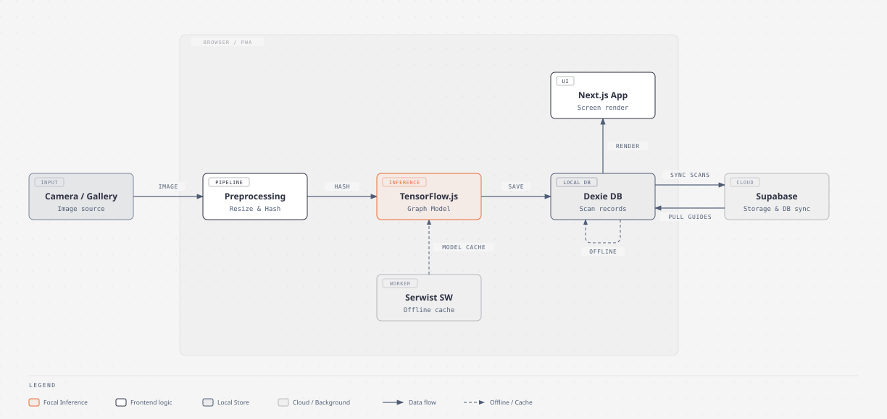

# MangoLeaf AI Architecture

## System overview

MangoLeaf AI is a client-heavy, offline-first Next.js 16 application. The browser is the primary runtime: it loads the TensorFlow.js model, performs image classification, stores scan records in IndexedDB, and queues synchronization work. Supabase adds backup, image hosting, and shared treatment-guideline updates when the device is online.



## Project structure

The tree below highlights the files and directories that define the application. Generated directories such as `.next/` and `out/` are intentionally omitted. A few listed files are marked local only, meaning they are gitignored working notes that are not part of a fresh clone.

```text
mangoleaf-ai/
|-- .github/workflows/ci.yml        # Security and app checks on master pushes
|-- .husky/pre-commit               # Format staged files before committing
|-- .husky/pre-push                 # Security, TypeScript, lint, and formatting checks
|-- tools/                          # Shared scanner setup, security checks, export verification, and tests
|-- public/                         # Files served directly from the site root
|   |-- images/
|   |   |-- icons/
|   |   |   |-- png/                # PWA, favicon, and Apple touch icons
|   |   |   `-- svg/                # Vector application and favicon icons
|   |   `-- mangoleaf-architecture.svg  # Diagram embedded by this document
|   |-- model/                      # TensorFlow.js model JSON, weight shards, and model_config.json
|   `-- sw.js                       # Generated Serwist service worker; do not edit
|-- src/                            # Application source code
|   |-- app/                        # Next.js App Router entry points
|   |   |-- globals.css             # Global Tailwind and application styles
|   |   |-- layout.tsx              # Root document, metadata, fonts, and viewport
|   |   |-- manifest.ts             # Installable PWA manifest
|   |   `-- page.tsx                # Main client-side application coordinator
|   |-- components/                 # Reusable interface components, grouped by role
|   |   |-- brand/                  # Application logo and icon set
|   |   |-- layout/                 # Top header, navigation bar, footer, and splash screen
|   |   |-- modal/                  # Legal dialog, scan-details dialog, scan bottom sheet
|   |   |-- scan/                   # Scan controls, result card, history list, guide
|   |   `-- tab/                    # Home, history, and about screen content
|   |-- hooks/
|   |   |-- usePWAInstall.ts        # PWA installation prompt state and actions
|   |   `-- useSync.ts              # IndexedDB and Supabase synchronization
|   |-- lib/
|   |   |-- classifier.ts           # Model loading, inference, hashing, compression
|   |   |-- constants.ts            # Model classes, fallback guidance, model version label
|   |   |-- db.ts                   # Dexie database schema and record types
|   |   |-- format-time-ago.ts      # Relative timestamp formatting for scan cards
|   |   |-- get-badge-styles.ts     # Disease-name to badge color class mapping
|   |   |-- supabase-client.ts      # Browser-side Supabase client
|   |   `-- translations.ts         # English and Cebuano/Bisaya interface text
|   |-- env.d.ts                    # Types for build-time injected public env values
|   `-- sw.ts                       # Serwist source configuration
|-- docs/                           # Detailed engineering and project history
|   |-- model-training/             # Trial 1, Trial 2, Trial 2.1, and Trial 3 training reports
|   |   |-- trials/                 # One report card per trial (TRIAL_v1.md … TRIAL_v3.md)
|   |   |-- figures/                # Per-trial training/tuning figures, one folder per trial
|   |   |-- artifacts/              # Per-trial run_record.json and model_config.json evidence
|   |   `-- (per-trial dirs above echo the notebooks/ folder-per-trial layout)
|   |-- ARCHITECTURE.md             # This architecture reference
|   |-- EMAIL_DISPATCH_WORKFLOW.md  # Adviser and panel correspondence notes (local only, gitignored)
|   |-- MANUSCRIPT_MODIFICATIONS.md # Manuscript corrections traced to measured results (local only, gitignored)
|   |-- MODEL_VERSIONING.md         # App, model, notebook, and release versioning
|   |-- PERFORMANCE.md              # Performance decisions and measurements
|   `-- PROGRESS.md                 # Development timeline and current baseline
|-- notebooks/                      # Colab notebooks, one folder per trial; all kept
|   |-- v1/
|   |   `-- MangoLeaf_AI_Training_v1.ipynb                  # Historical Trial 1
|   |-- v2/
|   |   `-- MangoLeaf_AI_Training_v2.ipynb                  # Historical Trial 2
|   |-- v2.1/
|   |   |-- MangoLeaf_AI_Training_v2.1.ipynb                # Trial 2.1 template, outputs cleared
|   |   |-- MangoLeaf_AI_Training_v2_1_Post_Training.ipynb  # Completed Trial 2.1 run, do not rerun
|   |   `-- MangoLeaf_AI_Threshold_Fitting_v2_1_1_Results.ipynb # Trial 2.1 margin and entropy fitting, no retraining
|   `-- v3/
|       |-- MangoLeaf_AI_Training_v3.ipynb                  # Current retraining template, 34 cells, outputs cleared
|       |-- MangoLeaf_AI_Training_v3_1st_to_8th_Cells_Results.ipynb # Partial Trial 3 run, data-preparation cells only
|       |-- MangoLeaf_AI_Training_v3_Post_Training.ipynb    # Completed Trial 3 run, manuscript evidence, do not rerun
|       |-- MangoLeaf_AI_Threshold_Fitting_v3.ipynb         # Trial 3 threshold template, 8 cells, outputs cleared
|       `-- MangoLeaf_AI_Threshold_Fitting_v3_Results.ipynb # Trial 3 fitting run; cell 9 settles the margin at 0.40
|-- video/                           # Promotional video, a separate HyperFrames project
|   |-- assets/                      # Render inputs plus the thumbnail still
|   |-- index.html                   # Root composition and timeline
|   |-- index.motion.json            # Motion and keyframe definitions
|   |-- hyperframes.json             # Composition paths and media settings
|   |-- meta.json                    # Composition id and name
|   |-- package.json                 # Pinned hyperframes CLI scripts
|   |-- AGENTS.md                    # HyperFrames instructions for coding agents
|   `-- MangoLeafAI-walkthrough.mp4  # Rendered output
|-- .env.example                     # Public environment-variable template
|-- AGENTS.md                        # Repository instructions for coding agents
|-- README.md                        # Project overview and quick start
|-- SETUP.md                         # Complete local and Supabase setup guide
|-- next.config.ts                   # Static export and Serwist integration
|-- package.json                     # Bun scripts and project dependencies
`-- tsconfig.json                    # TypeScript and @/* path-alias configuration
```

This is a single Next.js application rather than separate frontend and backend folders. Browser code owns diagnosis and local storage, while Supabase is an external synchronization service.

`video/` is the one directory that is not part of the application. It is a self-contained HyperFrames composition project for the promotional video, with its own `package.json`, its own dependency tree, and its own `AGENTS.md`. Nothing in it is imported by `src/`, and nothing in it reaches a device: `public/` is the only directory a static export copies verbatim, so the composition, the voice-over, and the rendered MP4 are absent from `out/` and from the service worker's precache manifest. The `static-video-assets` runtime cache in `public/sw.js` is unrelated to it and matches only `.mp4` and `.webm` files the app itself requests. Treat the two projects as neighbours that share a repository and nothing else; running `bun install` at the root does not install the video project's dependencies, and `bun run build` does not render the video.

## Application layers

### App shell and orchestration

- `src/app/layout.tsx` defines metadata, fonts, viewport behavior, and the root document.
- `src/app/manifest.ts` defines installable PWA metadata and icons.
- `src/app/page.tsx` is the main client coordinator for navigation, model loading, image selection, diagnosis, language state, scan history, and modals.

### User interface

Reusable UI lives in `src/components/`. Filenames use lowercase kebab-case, while exported React components remain PascalCase. For example, `modal/scan-details-modal.tsx` exports `ScanDetailsModal`. Components wrapped in `React.memo()` name the inner function after the export so React DevTools and stack traces show the real component name.

Components are grouped into subfolders by the role they play rather than kept in one flat directory:

| Folder    | Contents                                                                                                                  | Role                                    |
| --------- | ------------------------------------------------------------------------------------------------------------------------- | --------------------------------------- |
| `brand/`  | `logo.tsx`, `icon.tsx`                                                                                                    | Identity marks and the shared icon set  |
| `layout/` | `top-header.tsx`, `bottom-nav.tsx`, `footer.tsx`, `splash-screen.tsx`                                                     | Application frame around screen content |
| `modal/`  | `legal-modal.tsx`, `scan-details-modal.tsx`, `scan-sheet.tsx`                                                             | Overlay dialogs and sheets              |
| `scan/`   | `diagnostic-scanner.tsx`, `scan-card.tsx`, `scan-history-list.tsx`, `how-it-works-steps.tsx`, `disease-coverage-card.tsx` | Diagnosis feature surface               |
| `tab/`    | `home-tab.tsx`, `history-tab.tsx`, `about-tab.tsx`                                                                        | One component per navigation tab        |

The three tab components are the boundary between `page.tsx` and screen content. `page.tsx` owns all state and handlers, and renders exactly one of `HomeTab`, `HistoryTab`, or `AboutTab` per active tab. Adding a screen means adding a tab component and one branch in `page.tsx`, not editing shared markup.

Grouping is by role, not by which tab uses a file. `scan/scan-history-list.tsx` is rendered by both `HistoryTab` in full and by `HomeTab` as a four-item preview, so it belongs to the scan feature rather than to either tab. Folders group files for navigation and do not define access boundaries.

`modal/scan-sheet.tsx` is the sharper case of the same rule: it is a dismissible bottom sheet, so it is grouped with the overlays even though its content is the camera-or-gallery choice that starts a scan. It is also the one component that reaches outside React to drive another file's markup.

**The sheet's drag deliberately bypasses React, and that is not an oversight to tidy up.** The drag-move handler assigns `sheetRef.current.style.transform` and `backdropRef.current.style.opacity` directly instead of calling `setState`, because a `touchmove` handler runs at the digitizer's sampling rate and a React re-render per event is far more work than the one style write the frame needs. To keep the imperative writes and React consistent, the render path reads `dragYRef.current` rather than the `dragY` state while a drag is in progress, so an unrelated parent re-render commits the live drag offset instead of a stale zero. `dragY` state is written only at drag end, which is what lets React clear the imperative `transform` and run the snap-back or dismiss transition. Reverting any one of those three pieces to ordinary state breaks the other two. `page.tsx` renders two hidden `<input type="file">` elements carrying the ids `scan-camera-input` and `scan-gallery-input`, and the sheet calls `document.getElementById` on those ids and clicks the input directly, because a file picker only opens from a real user gesture on the input itself. **Renaming or removing either id breaks image selection silently:** the lookup returns `null`, the sheet still closes, and nothing reports an error. Keep the ids and the sheet in step, and keep both inputs mounted whenever the sheet can be opened. That obligation is why the desktop sheet, which since `v0.4.3` shows only the gallery card because a desktop browser ignores `capture="environment"`, hides the camera _button_ with `md:hidden` and leaves `scan-camera-input` mounted: the retake flow in `page.tsx` reopens whichever picker was last used, keyed by that id, so unmounting the input would break retake for camera-captured photos on phones.

A reusable SVG belongs in `brand/icon.tsx` under a name in the exported `IconName` union, not inline in whichever component needs it first. Icons that share the 24x24 stroke wrapper are held in the `STROKE_24_SHAPES` map, so adding one is a shape entry rather than another render branch. No entry hardcodes a colour or a size: every icon inherits `currentColor` from the surrounding text colour and takes its pixel dimensions from the `size` prop, which is what lets one shape serve call sites with different colours. Two entries can look like duplicates without being interchangeable. `camera` is a filled FontAwesome glyph on a 640x640 viewBox and `camera-outline` is a stroked viewfinder on a 24x24 one, so they are separate names rather than one icon with a variant flag.

Use the `@/components/...` path alias for imports across folders, and relative `./` paths only within the same folder, so a file can be moved without rewriting unrelated paths.

### Presentation helpers

Two pure formatting functions in `src/lib/` are kept out of the components that render them so the component files stay markup-only:

- `format-time-ago.ts` turns a scan's ISO `updated_at` into a relative label. It reads every string from `translations.ts`, including the `{n}` count templates for minutes, hours, and days and the `monthsShort` abbreviations used for dates older than a week, so the label is fully localized in both languages. Month names come from `translations.ts` rather than `toLocaleDateString` because browsers have no reliable Cebuano/Bisaya month data. An unparseable timestamp returns the `justNow` label instead of falling through to a `NaN` date.
- `get-badge-styles.ts` maps a disease name to the shared red disease-badge classes or the green healthy-badge classes. It matches on substrings, so an unrecognized class name falls back to neutral slate styling rather than throwing.

Both are imported by `scan/scan-card.tsx`. Neither imports React, so both can be called from any component or tested directly.

When adding a relative-time string, add it to both the `en` and `bis` objects in `translations.ts` and use the `{n}` placeholder for any number. Cebuano/Bisaya does not inflect nouns for plurals, so only English needs separate singular and plural forms.

### On-device AI pipeline

`src/lib/classifier.ts` owns the browser inference flow:

1. Load `/model/model.json` with `tf.loadGraphModel`, fetching `/model/model_config.json` concurrently for the rejection thresholds.
2. Cache and warm the model once per browser session.
3. Downscale the image to `224 x 224` with a shared canvas.
4. Run TensorFlow.js inference and dispose temporary tensors.
5. Apply three rejection gates and return the highest-probability class only if all three pass; otherwise return `Uncertain / Unrecognized`.
6. Compress the image for storage and calculate a SHA-256 hash for duplicate detection.

**Rejection is three gates, not one, and all three must pass.** A prediction is accepted only when `meetsConfidence && meetsMargin && meetsEntropy`:

| Gate       | Test                                                 | Source                           | Current value |
| ---------- | ---------------------------------------------------- | -------------------------------- | ------------- |
| Confidence | Top-1 probability at least the threshold             | Hardcoded `CONFIDENCE_THRESHOLD` | `0.70`, fixed |
| Margin     | Top-1 minus top-2 probability at least the threshold | `model_config.json`              | `0.40`        |
| Entropy    | Normalized Shannon entropy at most the threshold     | `model_config.json`              | `0.40`        |

The confidence floor is hardcoded and deliberately not configurable. It is a manuscript specification cited to [31], so a `model_config.json` that asks for a different value is refused: the classifier logs a warning and keeps `0.70`. Margin and entropy are the opposite: both start `null`, and `null` disables that gate. A missing or malformed config therefore degrades to the confidence gate alone rather than blocking a scan, which is why a device can run on one gate without any visible error. The console line `Model config loaded: margin=..., entropy=...` printed at startup is the only way to tell from the app which gates are live, and it is what the production phone checks in `docs/PROGRESS.md` look for.

Entropy is normalized by `Math.log(results.length)` so it stays on a 0-to-1 scale comparable to the fitted threshold regardless of class count. Confidence is compared before rounding; the rounded value is returned for display only, because comparing the rounded number would let `0.695` clear a `0.70` gate and silently lower the real floor to 69.5%.

The model assets are committed under `public/model/` and contain six output classes defined in `src/lib/constants.ts`. Both fitted thresholds are properties of one specific set of weights, so `model_config.json` is replaced together with the shards and never carried across a model swap. See `docs/MODEL_VERSIONING.md`.

### Local persistence

`src/lib/db.ts` defines the Dexie database `MangoLeafDB` with two stores:

- `scans`: image blobs, predictions, sync metadata, timestamps, and device ownership.
- `guidelines`: cached English and Cebuano/Bisaya treatment guidance. Disease and healthy presentation colors are fixed in the client, not stored in Supabase.

New scans are written locally first. This allows diagnosis and history features to keep working without a network connection.

### Synchronization

`src/hooks/useSync.ts` coordinates Supabase synchronization:

- Creates a stable per-browser `device_id` in `localStorage`.
- Uploads pending image blobs to the public `scans` Storage bucket.
- Inserts scan metadata into the `scans` table.
- Marks deletions locally and removes remote rows/files when online.
- Pulls the current device's remote scans for history restoration.
- Pulls and caches treatment guidelines.
- Subscribes to Realtime changes for the `guidelines` table.
- Uses a sync lock with one queued follow-up pass, a real 10-second Storage upload timeout, exponential retry while online, and an immediate retry when the app returns to foreground.

Supabase is therefore a synchronization and recovery layer; IndexedDB remains the immediate source used by the UI.

### PWA and offline caching

`src/sw.ts` configures Serwist. It precaches the generated application assets, claims active clients, applies a `CacheFirst` strategy to `/model/*`, and adds its own `activate` handler that deletes every superseded model cache listed in `OUTDATED_MODEL_CACHES`. `next.config.ts` integrates Serwist, disables it during development, and enables static export. It also reads the `version` field from `package.json` and injects it as `NEXT_PUBLIC_APP_VERSION`, which Next replaces with a literal string at build time wherever the code references it. Because the site is a static export, every public value must be baked in during the build; nothing is resolved at runtime. See `docs/MODEL_VERSIONING.md`.

The precache manifest that Serwist generates covers the build output _and every file under `public/`_. Anything added to `public/` is therefore downloaded to each installed device during service-worker installation, whether or not the application ever requests it. Keep assets that only documentation uses out of `public/` unless they also have to be reachable at a site URL.

**That manifest, not the `CacheFirst` rule, is what actually updates the model.** `PrecacheRoute` is registered before `runtimeCaching`, so the router matches it first and the `/model/*` rule never fires in practice. Every file under `public/model/` carries a content-revision hash in the manifest, so a changed weight shard is refetched on the next service-worker activation regardless of the cache name, and Serwist's own `activate` handler evicts precache entries missing from the current manifest. The `MODEL_CACHE` bump and the `OUTDATED_MODEL_CACHES` eviction are therefore defence in depth whose real payoff is reclaiming several megabytes of superseded weights, not the update mechanism. Do not treat an inspection of `CacheStorage` as verification: the current `mangoleaf-model-cache-v3-0-0` can legitimately be empty on a correctly updated device.

### Static assets

Application images live under `public/images/`, with the icon set in `public/images/icons/png/` and `public/images/icons/svg/`. The PNG icons are not decorative: `src/app/manifest.ts` declares the 192x192 and 512x512 files as `maskable`, and browsers refuse to offer the install prompt when a declared icon of at least 192x192 cannot be fetched. `src/app/layout.tsx` points the favicon and Apple touch icon at the same tree. Renaming or moving this directory means updating both files and rebuilding.

These files must stay tracked in git. `.gitignore` patterns that could match them need a leading slash so they stay anchored to the repository root; a bare pattern such as `images` matches a directory of that name at _any_ depth and silently excludes `public/images/`. Such a mistake does not surface in `git status`, because ignored paths are not reported as untracked, and it cannot be undone with a negation such as `!public/images/`, because git never descends into a directory that a parent pattern has excluded. The symptom appears only after a fresh clone or a deployment build: no favicon, and an uninstallable PWA.

## Data flow for a scan

1. The user captures or selects an image.
2. The app hashes the original file and checks IndexedDB for a duplicate.
3. The classifier preprocesses the image and runs on-device inference.
4. The result and compressed image are saved to IndexedDB with `pending-insert` status.
5. The scan appears immediately in the UI through Dexie live queries.
6. If online, synchronization uploads the image and inserts the remote metadata row.
7. The local record becomes `synced`; failed operations remain pending for a later retry.

## Build and deployment constraints

- The project uses Next.js App Router inside `src/app`.
- `output: "export"` produces a static site in `out/`.
- Server-only Next.js features are not part of the current architecture.
- The Serwist integration currently uses webpack, matching the installed Next.js PWA guidance.
- The deployed origin must serve model files and the service worker from the expected root paths.

### Local checks and continuous integration

Husky registers `.husky/pre-commit` and `.husky/pre-push` during root dependency installation. Before commits, `lint-staged` formats staged files with Prettier and stages the fixes. `.prettierignore` keeps generated assets, model files, notebooks, and the separate video project outside formatting. Before upload, the push hook checks secrets and private filenames with `tools/check-security.mjs`, then runs TypeScript, ESLint, and Prettier's check-only command. The security scan includes tracked filenames and fetched Git history, including explicit push commits. `tools/install-gitleaks.mjs` installs the pinned, checksum-verified scanner under ignored `.tools/`. No scanner code or binaries are included in the application export.

`.github/workflows/ci.yml` runs only on pushes to `master`. Independent security and application jobs repeat the history scan and perform typecheck, lint, formatting checks, static build, and exported-asset verification. CI invokes checks directly with Husky disabled. The build uses public-client fallback settings and does not deploy; production configuration and hosting deployment remain separate. Local checks can stop an upload, while CI reports failures after the push. See [SETUP.md](../SETUP.md#local-security-checks-and-github-ci) for installation, file rules, and limits.

## Naming and organization conventions

- Source filenames: lowercase kebab-case for multiword files.
- React component identifiers: PascalCase.
- Custom hooks: camelCase `useSomething.ts` filenames with matching `useSomething` exports.
- Detailed engineering and history documentation: `docs/`.
- Root documentation: `README.md` for the overview, `SETUP.md` for installation, and `AGENTS.md` for coding-agent instructions.
- Generated files such as `public/sw.js`, `.next/`, `out/`, and `next-env.d.ts` should not be edited by hand.
