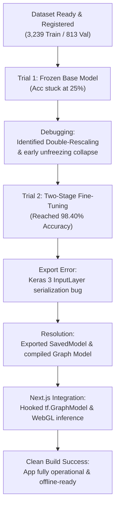

# MangoLeaf AI: Model Training, Debugging, and PWA Integration Report

> **Current-model note, October 2, 2026:** The adopted application model is [V4.3.0 Combined](../v4.3.0/TRIAL_v4_3_0.md#current-model-adoption-october-2-2026), replacing V3 as the adopted baseline. This Trial 1 report and its earlier reading note remain historical evidence.

> **Reading note, September 21, 2026:** This is a historical Trial 1 record. Its code examples, UI, and performance claims describe that period, not the current application or measured physical-device reliability. The current model report is [Trial 3](../v3/TRIAL_v3.md); use [TESTING.md](../../../testing/TESTING.md) for current test requirements. Historical measurements below are preserved.

This document records the step-by-step development process, troubleshooting, and final integration of the on-device image classification model completed on **July 20-21, 2026**.

---

## Development Timeline Overview



---

## Step-by-Step Chronicles

### Phase 1: Dataset Verification & Mounting

- **Action:** Mounted Google Drive to Google Colab and loaded raw images.
- **Result:** Successfully registered:
  - **3,239 training images**
  - **813 validation images**
  - Sorted into **6 target classes**: `anthracnose`, `bacterial_black_spot`, `bacterial_canker`, `healthy`, `mango_scab`, and `sooty_mold`.

### Phase 2: First Training Attempt (Underfitting & Collapse)

- **Setup:** MobileNetV3-Large base model frozen (`trainable = False`), custom classification head attached, and trained with default parameters.
- **The Failure:** Validation accuracy froze flat at **25.22%** across 15 epochs.
- **Root Cause 1 (Double-Rescaling):** The generator applied `rescale=1./255`, but MobileNetV3-Large has an **internal** rescaling layer. This divided values by 255 twice, reducing pixels to a range of `[0.0, 0.003]` (appearing completely black to the AI).
- **Root Cause 2 (Feature Generalization):** Locking the base layers prevented the model from adjusting its visual "eyes" to detect specific agricultural mango leaf spots that imageNet (general cats/dogs dataset) had never seen.

### Phase 3: Implementing Two-Stage Fine-Tuning (The Fix)

- **Action:**
  1. Removed `rescale=1./255` from loaders, feeding raw `[0, 255]` pixels into MobileNetV3's internal layer.
  2. Implemented the **two-stage training** strategy outlined in the Capstone manuscript:
     - **Stage 1 (5 Epochs):** Kept base layers frozen; trained the classification head at a default rate (`0.001`) to stabilize the weights.
     - **Stage 2 (10 Epochs):** Unfroze all layers; trained the entire model at a slow, controlled learning rate of **`0.00001` (1e-5)** to adapt the convolutional layers without destroying pre-trained knowledge.
- **The Victory:** Validation accuracy shot up to **`0.9840` (98.40%)** with a validation loss of **`0.0412`**, signifying high accuracy and excellent generalization with zero overfitting.

### Phase 4: Keras 3 Serialization & Graph Model Conversion

- **The Error:** Saving to a standard `.h5` file generated a `model.json` config layout that caused the browser to throw:

  `Error: An InputLayer should be passed either a batchInputShape or an inputShape.`

- **Root Cause:** Colab's default **Keras 3** environment has a functional layers serialization bug that strips input shape dimensions from exported sequential sub-networks during standard Layer saves.
- **The Fix:**
  1. Switched saving format in Python to a standard TensorFlow SavedModel folder using `model.export('mangoleaf_saved_model')`.
  2. Compiled it via CLI into a web-optimized **TensorFlow.js Graph Model** (`--input_format=tf_saved_model`), stripping away Keras classes and turning the model into flat, fast mathematical operations.
  3. Switched browser loader in Next.js from `tf.loadLayersModel` to **`tf.loadGraphModel`**.

---

## Final Deliverables & File Sizes

The final compiled AI is extremely lightweight (only **6.1 MB total**), meaning it downloads in less than a second and operates 100% in client-side memory:

| Filename                   | Description                        | File Size                       |
| :------------------------- | :--------------------------------- | :------------------------------ |
| **`model.json`**           | Map layout of the AI neural layers | **219 KB** (`224,446 bytes`)    |
| **`group1-shard1of2.bin`** | Primary binary weights shard       | **4.00 MB** (`4,194,304 bytes`) |
| **`group1-shard2of2.bin`** | Secondary binary weights shard     | **1.89 MB** (`1,983,112 bytes`) |
| **Total Size**             | **Full on-device AI system**       | **6.10 MB**                     |

---

## Code Implementation Details (PWA Frontend)

```typescript
// Located inside src/app/page.tsx
// 1. Model Loading
const [model, setModel] = useState<tf.GraphModel | null>(null);
useEffect(() => {
  async function loadModel() {
    await tf.ready();
    const loadedModel = await tf.loadGraphModel("/model/model.json");
    setModel(loadedModel);
  }
  loadModel();
}, []);

// 2. On-Device WebGL Inference
const results = tf.tidy(() => {
  const tensor = tf.browser.fromPixels(imgElement);
  const resized = tf.image.resizeBilinear(tensor, [224, 224]);
  const batched = resized.cast("float32").expandDims(0);
  const prediction = model.predict(batched) as tf.Tensor;
  return prediction.dataSync();
});
```

- **WebGL GPU Execution:** Prediction processes locally in the farmer's browser using the device's hardware acceleration.
- **Zero Memory Leaks:** The tensor computations are fully enclosed in `tf.tidy()` to immediately dump temporary tensors from VRAM, keeping low-end mobile devices safe from "Aw, Snap!" tab crashes.
- **70% Confidence Threshold:** A confidence check ensures that any image below 70% probability displays as _"Uncertain / Unrecognized"_, under the project's 70% confidence rejection rule.
