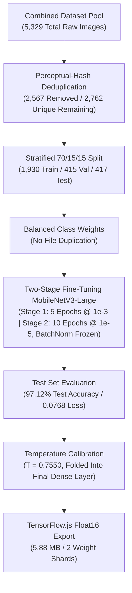

# MangoLeaf AI: Trial 2.1 Model Training & Performance Evaluation Report

> **Notebook location update, October 2, 2026:** Preserved Trial 2.1 training and threshold-fitting notebooks now live under [`notebooks/non-experiment/v2.1/`](../../../../notebooks/non-experiment/v2.1/). Original notebook paths below remain historical provenance. Use the [notebook index](../../../../notebooks/README.md) for current locations; saved notebook contents and outputs are unchanged.

> **Current-model note, October 2, 2026:** The adopted application model is [V4.3.0 Combined](../v4.3.0/TRIAL_v4_3_0.md#current-model-adoption-october-2-2026), replacing V3 as the adopted baseline. This Trial 2.1 report and its earlier reading note remain historical evidence.

> **Reading note, September 21, 2026:** [Trial 3](../v3/TRIAL_v3.md) superseded this model on August 27, 2026. “Shipping model” and “before the v3 run” below refer to the original Trial 2.1 period. Keep these results as evidence; follow [AI model versioning](../../../versions/AI_MODEL_VERSIONING.md) and [TESTING.md](../../../testing/TESTING.md) for current candidate and browser/device checks. Weight-conversion probes and historical precision estimates are not proof of identical behavior on every phone.

This document records the dataset deduplication, class-weighted two-stage fine-tuning, temperature calibration, and Float16 export for **Trial 2.1** of the on-device image classification model, completed on **August 22, 2026**.

Notebook provenance: the clean template is `notebooks/v2.1/MangoLeaf_AI_Training_v2.1.ipynb` and the completed run with all outputs preserved is `notebooks/v2.1/MangoLeaf_AI_Training_v2_1_Post_Training.ipynb`. Trial 2 remains recorded in [TRIAL_v2.md](../v2/TRIAL_v2.md); this trial supersedes it as the shipping model.

Trial 2.1 reports a **lower** test accuracy than Trial 2 (97.12% against 98.25%) and that is the point of the trial. Trial 2's test set contained near-duplicate copies of its own training images, so part of its score measured memorization rather than generalization. Removing the duplicates removed that inflation.

---

## Development Timeline & Architecture Overview

---

## Step-by-Step Trial 2.1 Chronicles

### Phase 1: Perceptual-Hash Deduplication

Trial 2's dataset was pooled from local field photos and two open repositories, and the open repositories had already been augmented by Roboflow. That produced rotated, flipped, and re-encoded copies of the same physical leaf sitting in the same folder. A random file-level split therefore scattered copies of one leaf across train, validation, and test.

- **Method:** `imagehash.phash` computed over all 8 dihedral variants of each image (4 rotations x 2 mirror states), taking the lexicographic minimum as the canonical key. Two images that differ only by rotation or flipping produce the same canonical hash, which is exactly the Roboflow augmentation pattern.
- **Grouping:** pairwise Hamming distances, then greedy selection inside each source folder so every survivor is further than the threshold from every other survivor in that folder.
- **Threshold:** `PHASH_DISTANCE = 5`, chosen from the nearest-neighbour distance table below.

#### Nearest-Neighbour Distance Distribution (5,329 images)

| Distance | Images | Cumulative | Interpretation                                         |
| :------: | :----: | :--------: | :----------------------------------------------------- |
|  **0**   | 4,308  |   4,308    | An identical-looking image exists elsewhere in the set |
|  **2**   |   13   |   4,321    | Re-encoded or resized copy                             |
|  **4**   |   30   |   4,351    | Re-encoded or resized copy                             |
|  **6**   |   97   |   4,448    | Different photograph of the same physical leaf         |
|  **8**   |  191   |   4,639    | Different photograph of the same physical leaf         |
|  **10**  |  286   |   4,925    | Different photograph of the same physical leaf         |
|  **12**  |  234   |   5,159    | Borderline                                             |
| **>12**  |  170   |   5,329    | Genuinely unrelated images                             |

4,308 of 5,329 images have a distance-0 twin. That single number is why Trial 2's test score was inflated.

#### Removal by Source Folder

| Source Folder              | Raw Images | Redundant | Unique Kept |
| :------------------------- | :--------: | :-------: | :---------: |
| **`anthracnose`**          |   1,177    |    700    |     477     |
| **`bacterial_black_spot`** |    300     |     4     |     296     |
| **`bacterial_canker`**     |   1,194    |    703    |     491     |
| **`healthy_fruit`**        |    300     |    81     |     219     |
| **`healthy_leaf`**         |   1,196    |    701    |     495     |
| **`mango_scab`**           |    300     |     9     |     291     |
| **`sooty_mold`**           |    862     |    369    |     493     |
| **TOTAL**                  | **5,329**  | **2,567** |  **2,762**  |

1,777 duplicate groups, 48.2% redundancy. Deduplication runs inside each source folder, before the `healthy_leaf` and `healthy_fruit` merge, so the merged `healthy` class holds 495 leaf images and 219 fruit images.

Note that `bacterial_black_spot` and `mango_scab` lost almost nothing, 4 and 9 images: those two folders are original field photography that Roboflow never inflated. Every other class shrank by roughly 60%. This is the root cause of the class-imbalance pattern in the results below.

### Phase 2: Stratified Split & Leakage Verification

- **Split:** 70/15/15 stratified by class, seed fixed for reproducibility. The ratio is stated in the manuscript and was not changed.
- **Merging:** `healthy_leaf` and `healthy_fruit` are merged into one `healthy` class, as in Trial 2. The model has exactly 6 output classes.

| Target Disease Class       |    Train (70%)    | Validation (15%) |   Test (15%)    |   Total   |
| :------------------------- | :---------------: | :--------------: | :-------------: | :-------: |
| **`anthracnose`**          |        333        |        72        |       72        |    477    |
| **`bacterial_black_spot`** |        207        |        44        |       45        |    296    |
| **`bacterial_canker`**     |        343        |        74        |       74        |    491    |
| **`healthy`**              |        499        |       107        |       108       |    714    |
| **`mango_scab`**           |        203        |        44        |       44        |    291    |
| **`sooty_mold`**           |        345        |        74        |       74        |    493    |
| **TOTAL**                  | **1,930 (69.9%)** | **415 (15.0%)**  | **417 (15.1%)** | **2,762** |

- **Exact-duplicate leakage:** none. No source image appears in more than one split.
- **Near-duplicate leakage:** 5 pairs straddle two splits. All 5 are cross-folder pairs, meaning the two images carry different labels, so per-folder deduplication cannot remove them by construction. They inflate test accuracy very slightly. Recorded here for the manuscript; inspect before any v3 run.
- **Cross-label duplicates:** 49 pairs, all `anthracnose` against `healthy`. The same image under two labels means one label is wrong. Nothing was deleted for these. They must be inspected by hand before a v3 run.

### Phase 3: Class Weights Instead of File Duplication

Trial 2 duplicated minority-class files on disk before training. Trial 2.1 uses `compute_class_weight('balanced')` instead, which penalizes minority-class errors more heavily without writing a single extra file. Duplicated files would have re-entered the deduplication problem the trial exists to solve.

| Class                      | Train Images | Loss Weight |
| :------------------------- | :----------: | :---------: |
| **`anthracnose`**          |     333      |    0.966    |
| **`bacterial_black_spot`** |     207      |    1.554    |
| **`bacterial_canker`**     |     343      |    0.938    |
| **`healthy`**              |     499      |    0.645    |
| **`mango_scab`**           |     203      |    1.585    |
| **`sooty_mold`**           |     345      |    0.932    |

Augmentation is applied live in the `tf.data` pipeline every epoch (rotation, horizontal flip, zoom, brightness, shear), so no augmented file is ever written to disk. Across 15 epochs the model saw 1,930 x 15 = **28,950 augmented presentations** of 1,930 distinct images.

### Phase 4: Two-Stage Fine-Tuning

- **Architecture:** MobileNetV3-Large with ImageNet weights, Global Average Pooling, 20% Dropout, Dense(6) logits, Softmax. Input is raw `[0, 255]`; MobileNetV3 rescales internally through its own `Rescaling` layer, so no manual normalization is applied anywhere in the notebook or the app.
- **Stage 1 (5 epochs, lr `1e-3`):** base frozen, head only. Ended at `val_accuracy 0.9639`, `val_loss 0.1164`.
- **Stage 2 (10 epochs, lr `1e-5`):** base unfrozen, **all 46 BatchNormalization layers explicitly frozen**, leaving 80 trainable weight tensors. Ended at `val_accuracy 0.9783`, `val_loss 0.0680`.

The BatchNormalization freeze is the fix for Trial 2's fine-tuning collapse. In Trial 2, accuracy fell from `0.9735` at the end of stage 1 to `0.8535` at the first stage-2 epoch, because unfreezing the base also unfroze the BatchNorm layers, letting them overwrite ImageNet's population statistics from small batches. With them frozen, stage 2 opened at `0.9735` and improved from there.

### Phase 5: Results

- **Test accuracy:** **97.12%** (405 of 417 correct, 12 errors)
- **Test loss:** **0.0768**
- **Best validation loss:** **0.0680**, at the final stage-2 epoch
- **95% Wilson score interval:** roughly **95.0% to 98.3%** on 417 images

#### Trial 2.1 Classification Report & F1-Scores

| Target Disease Class       | Precision  |   Recall   |  F1-Score  | Test Samples |
| :------------------------- | :--------: | :--------: | :--------: | :----------: |
| **`anthracnose`**          | **1.0000** | **1.0000** | **1.0000** |      72      |
| **`bacterial_canker`**     | **1.0000** | **1.0000** | **1.0000** |      74      |
| **`sooty_mold`**           | **1.0000** | **1.0000** | **1.0000** |      74      |
| **`healthy`**              | **1.0000** | **0.9907** | **0.9953** |     108      |
| **`bacterial_black_spot`** | **0.9048** | **0.8444** | **0.8736** |      45      |
| **`mango_scab`**           | **0.8333** | **0.9091** | **0.8696** |      44      |
| **OVERALL ACCURACY**       |     —      |     —      | **0.9712** |   **417**    |
| **MACRO AVERAGE**          | **0.9563** | **0.9574** | **0.9564** |   **417**    |

**Every one of the 12 errors involves `bacterial_black_spot` or `mango_scab`:** 7 `bacterial_black_spot` images predicted as `mango_scab`, 4 `mango_scab` images predicted as `bacterial_black_spot`, and 1 `healthy` image predicted as `mango_scab`. The other four classes are perfect.

Those are the only two classes that kept their original size after deduplication (296 and 291 unique, against 477 to 714 for the rest), and they are the two smallest classes in the training split (207 and 203 images). They are also genuinely similar: both present as dark surface lesions on fruit skin.

### Phase 6: Leakage Diagnostic (Ruling Out the Alternative Explanation)

Three classes score a perfect 1.0000, which normally warrants suspicion of residual leakage. A dedicated diagnostic counted, for every test image, whether a same-label training image sits within a given perceptual-hash distance.

| Class                      | Support | d<=5  |  d<=6  |  d<=8  |  d<=10  | F1-Score |
| :------------------------- | :-----: | :---: | :----: | :----: | :-----: | :------: |
| **`anthracnose`**          |   72    |   0   |   1    |   3    |   11    |  1.0000  |
| **`bacterial_canker`**     |   74    |   0   |   0    |   2    |    6    |  1.0000  |
| **`sooty_mold`**           |   74    |   0   |   0    |   4    |   16    |  1.0000  |
| **`healthy`**              |   108   |   0   |   8    |   27   |   54    |  0.9953  |
| **`bacterial_black_spot`** |   45    |   0   |   0    |   5    |   10    |  0.8736  |
| **`mango_scab`**           |   44    |   0   |   3    |   11   |   25    |  0.8696  |
| **TOTAL**                  | **417** | **0** | **12** | **52** | **122** |    —     |

The `d<=5` column is zero across the board, confirming deduplication worked at the configured threshold.

The result is the **inverse** of the leakage pattern. If leakage were driving the perfect scores, the perfect classes would have the most nearby training images. They have the fewest: `bacterial_canker` has 2 of 74 at `d<=8` and scores 1.0000, while `mango_scab` has 11 of 44 at `d<=8` and scores 0.8696. Residual overlap does not track performance, so **no leakage caveat is needed for the reported accuracy**. The `bacterial_black_spot` against `mango_scab` confusion is a genuine visual-similarity limit.

The `d<=12` and `d<=15` columns (220 and 306 of 417) are perceptual-hash noise at those distances, not leakage, and should not be cited.

### Phase 7: Temperature Calibration

A single scalar temperature `T` was fitted on the validation logits by minimizing negative log-likelihood, then folded into the final Dense layer as `W/T` and `b/T`.

| Quantity                           |  Before  |  After   |
| :--------------------------------- | :------: | :------: |
| Validation NLL                     |  0.0680  |  0.0648  |
| Mean top-1 confidence (validation) |  0.9655  |  0.9759  |
| Mean top-1 confidence (test)       |  0.9620  |  0.9722  |
| Test accuracy                      | 0.971223 | 0.971223 |

**Fitted temperature: T = 0.754966.** Accuracy is identical to six decimal places because argmax is invariant to division by a positive constant, so every number in the classification report above still stands after folding.

**`T < 1.0` means the model was underconfident, so folding raises confidence.** This has a direct consequence for the app: a fixed 70% confidence floor now rejects almost nothing, because mean top-1 confidence on the test set is 97.2%. The 70% threshold alone is not an out-of-scope rejector. The margin (top-1 minus top-2) and normalized-entropy checks are the load-bearing signals, and both are `null` in `model_config.json` because no out-of-scope image set existed to fit them against at export time.

---

## Final Deliverables & File Sizes

Exported as a TensorFlow.js **graph model** with **Float16 quantization**. The Keras 3 `InputLayer` serialization defect blocks the direct Keras path, so the route is `model.export()` to SavedModel, then `tensorflowjs_converter --input_format=tf_saved_model`, loaded in the app with `tf.loadGraphModel`.

| Filename                   | Description                         | File Size                       |
| :------------------------- | :---------------------------------- | :------------------------------ |
| **`model.json`**           | Graph topology & weight manifest    | **219.73 KB** (`225,001 bytes`) |
| **`group1-shard1of2.bin`** | Primary Float16 weights shard       | **4.00 MB** (`4,194,304 bytes`) |
| **`group1-shard2of2.bin`** | Secondary Float16 weights shard     | **1.67 MB** (`1,747,080 bytes`) |
| **`model_config.json`**    | Class order, input size, thresholds | **567 bytes**                   |
| **Total Size**             | **Full on-device AI system**        | **5.88 MB** (`6,166,952 bytes`) |

Graph signature: input `input_image` at `[None, 224, 224, 3]`, output `output_0` at `[None, 6]`.

### Float16 Quantization Verification

Quantization was verified by walking the shard bytes against the `weightsManifest` rather than trusting the file size alone:

- **199 of 199** float-valued weight tensors quantized to float16, **0** left as float32
- The manifest holds 212 entries in total. The other 13 are `int32` axis vectors (shape `[2]`) and padding specifications (shape `[4, 2]`), 50 scalars between them. They are indices rather than weights, so float16 cannot represent them by definition and the converter correctly leaves them alone.
- Bytes walked (5,941,384) equals bytes present in the shards, so the manifest offsets are exact
- **No `inf` or `NaN` anywhere in the shipped weights**
- 5,927,308 bytes saved against the same model exported without quantization, a **49.0%** reduction

### The Graph Is Structurally Identical to Trial 2

Because a smaller download invites the question of whether something was removed, the two `model.json` files were compared node by node. Trial 2's was recovered from git.

| Property                |   Trial 2   |       Trial 2.1        |
| :---------------------- | :---------: | :--------------------: |
| Graph nodes             |     461     |          461           |
| Distinct op types       |     15      |           15           |
| Convolution ops         |     62      |           62           |
| `BatchNorm` ops         |      0      |           0            |
| Weight manifest entries |     212     |          212           |
| Weight scalars          |  2,970,642  |       2,970,642        |
| Weights stored as       | 212 float32 | 199 float16 + 13 int32 |

**Zero op-count differences.** The two graphs execute the same arithmetic in the same order; only the storage format of the weights changed. Inference cost on device is therefore unchanged, and the saving is entirely a transfer saving: the whole `public/model/` directory drops from 11.51 MB to 5.88 MB, a **5.63 MB** reduction. (The 5.65 MB figure quoted in the verification section above is the weight shards alone, before the larger `model.json` and the new `model_config.json` are added back.)

`BatchNorm` ops are 0 in _both_, which confirms the converter folded them in Trial 2 as well. That is the mechanism described below, and it was already active before this trial.

`model.json` grew from 185,214 to 225,001 bytes despite the identical graph. The 39,787-byte increase is the `quantization` metadata block that each of the 199 quantized tensors gains in the manifest, at roughly 200 bytes each. It is bookkeeping, not complexity.

Before flipping the flag, a probe cast every weight to float16 and back and re-evaluated the whole test set:

| Measurement                      | Result              |
| :------------------------------- | :------------------ |
| Test accuracy, float32 weights   | 0.971223            |
| Test accuracy, float16 weights   | 0.971223            |
| Predicted class changed          | **0 of 417 images** |
| Crossed the 70% gate differently | **0 images**        |
| Largest top-1 confidence shift   | 0.040207            |
| Mean top-1 confidence shift      | 0.001191            |

The probe also found 1 weight of 3,002,118 above the float16 maximum of 65,504. That value does not reach the shipped model: the converter's graph optimization folds each BatchNormalization layer into the preceding convolution, so the oversized `moving_variance` becomes a scale of roughly `1/sqrt(65504) = 0.0039` multiplied into the kernel, which float16 represents exactly. The graph carries 2,970,642 scalars against the Keras model's 3,002,118, and that 31,476 difference is the folding. The probe was therefore the pessimistic case, and it measured zero accuracy cost.

**Accuracy is not the reason to prefer float16, and neither is speed.** TensorFlow.js decodes float16 shards back to float32 in JavaScript before uploading them to the GPU, so inference time and GPU memory are unchanged by the file format. The entire benefit is a 5.65 MB smaller download on a rural 3G connection. Separately, `src/lib/classifier.ts` sets `WEBGL_FORCE_F16_TEXTURES = true`, which stores weights in 16-bit GPU textures regardless of file format, so float32 precision was already being discarded on every WebGL device before this change.

---

## PWA Integration Notes

All three changes below are **applied** in the working tree as of August 23, 2026, verified by `typecheck`, `lint`, and `build` all exiting 0, and by inspecting the generated `public/sw.js`.

- **Rejection logic (`src/lib/classifier.ts`):** the confidence check now compares the raw probability. It previously rounded to two decimals before comparing, which let `0.695` clear the gate and made the effective threshold 69.5% rather than the specified 70%. Rounding now happens for display only, after every check has run.
- **Optional rejection signals (`src/lib/classifier.ts`):** margin and normalized entropy are read from `/model/model_config.json`, fetched in parallel with the weights so it costs no extra round trip. A `null` threshold disables its check, and an unreachable or malformed config leaves both `null` rather than blocking a scan. The 70% confidence floor stays hardcoded because it is a fixed specification rather than a fitted value; a config file that disagrees with it is logged as a warning and ignored.
- **Cache invalidation (`src/sw.ts`):** the Serwist `CacheFirst` rule for `/model/*` originally used no version in its cache name. The runtime cache name is now `mangoleaf-model-cache-v2-1-1`, and an `activate` handler deletes the superseded `mangoleaf-model-cache` and `mangoleaf-model-cache-v2-1` so the old 11.51 MB does not sit on the device forever. This was written on August 23 as the mechanism that stops an already-installed PWA from serving the Trial 2 weights forever, which is not correct: every file under `public/` also enters the Serwist precache manifest with a content-revision hash, and `PrecacheRoute` registers ahead of `runtimeCaching`, so the `CacheFirst` rule for `/model/*` never fires and the changed revision hash is what actually forces the refetch. The rename and the eviction handler are still worth keeping, as defence in depth and to reclaim the space. The practical consequence is that `mangoleaf-model-cache-v2-1-1` can legitimately be empty on a correctly updated device; verify a swap against the precache manifest in the generated `public/sw.js`, not against `CacheStorage` contents.
- **Version label (`src/lib/constants.ts`):** `modelVersion` is now `v2.1.1`, which is what the app footer displays. The label was `v2.1.0` on August 23 and was superseded the next day by the threshold-fitting run in the addendum below, before anything was committed.
- **Shard count changed from 3 to 2.** `group1-shard1of3.bin`, `group1-shard2of3.bin`, and `group1-shard3of3.bin` were deleted from `public/model/` during the swap, and `model_config.json` was added.

Class order in `model_config.json` was checked against `CLASSES` in `src/lib/constants.ts` before shipping. Both are alphabetical and they match. A mismatch here would mislabel every prediction without raising any error, so it is worth re-checking on every future swap.

---

## Open Items Before the v3 Run

1. ~~**Fit the margin and entropy thresholds.**~~ **Done on August 24, 2026** without retraining. Margin `0.55`, entropy `0.30`. See the addendum below.
2. ~~**Leave a safety band of at least 0.05.**~~ **Superseded.** That figure was the worst-case top-1 _confidence_ shift, which is the wrong quantity for these two signals. The shift was measured per signal instead: `0.010638` for entropy and `0.053285` for margin, scaled by 1.489 to `0.015841` and `0.079346` to account for `WEBGL_FORCE_F16_TEXTURES` activation quantization.
3. **Inspect the 49 cross-label near-duplicate pairs by hand.** Every one is `anthracnose` against `healthy`, so one label in each pair is wrong.
4. **Consider raising `STAGE2_EPOCHS` from 10.** Validation loss was still improving at the final stage-2 epoch, so training stopped early rather than converging. This is the cheapest available gain and it targets the two weak classes directly.
5. **Split by physical leaf group rather than by file** if a future dataset again contains multiple photographs of the same leaf. Deduplication removes copies, but grouping prevents the problem instead of repairing it.
6. **Collect more `bacterial_black_spot` and `mango_scab` field photographs.** They are the two smallest training classes at 207 and 203 images, and they account for all 12 test errors.

---

# Addendum — Model v2.1.1: Out-of-Scope Rejection Thresholds

**August 24, 2026. No retraining occurred.** The margin and entropy thresholds were fitted against the resume bundle saved by the Trial 2.1 run, so they match the weights already in `public/model/` exactly. The weight shards are byte-identical to the August 23 export; only `model_config.json`, `src/lib/constants.ts`, and `src/sw.ts` changed. This is an addendum rather than a new trial file precisely because no training happened.

Notebook: `notebooks/v2.1/MangoLeaf_AI_Threshold_Fitting_v2_1_1_Results.ipynb`, cells 4 through 9.

### Why the thresholds are needed

A six-class softmax is a closed set. The six probabilities always sum to 1.0, so a photograph of a lemon, a wall, or a hand is forced into one of the six mango classes and can receive a high confidence score. The 70% floor cannot fix this, and folding `T = 0.754966` made it weaker rather than stronger, because `T < 1.0` raises confidence. Two further signals derived from the same softmax output were added instead:

| Signal             | Definition                         | Threshold | Fitted or fixed                                          |
| :----------------- | :--------------------------------- | :-------- | :------------------------------------------------------- |
| Confidence         | max softmax probability            | `0.70`    | **Fixed** by the manuscript, cited to [31]. Never tuned. |
| Margin             | top-1 probability minus top-2      | `0.55`    | Fitted                                                   |
| Normalized entropy | Shannon entropy divided by `log 6` | `0.30`    | Fitted                                                   |

A prediction must clear all three to be accepted. Failing any one returns `Uncertain / Unrecognized`.

### Out-of-scope image set

168 non-mango photographs were collected, then split in half by a fixed seed: **84 for fitting** the thresholds and **84 held back for reporting**. The reported rejection rate is therefore measured on images the thresholds never saw. Both halves include other crops, soil, hands, sky, and unrelated objects; some are other mango diseases outside the six classes, which is legitimate, because anything not in the six classes is out of scope by definition.

### Measured results

| Metric                               | Value                                             |
| :----------------------------------- | :------------------------------------------------ |
| In-distribution retention            | **95.2%** (397 of 417 test images still accepted) |
| Out-of-scope rejection               | **51.2%** (43 of 84 reporting images rejected)    |
| 95% confidence interval on that rate | roughly **40.5% to 61.9%**                        |
| Accuracy on accepted predictions     | **99.24%**, up from 97.12%                        |
| Errors removed                       | 9 of the model's 12, three quarters               |

The confidence interval is wide because 84 images is a small sample. Quote it alongside the point estimate; a bare "51.2%" overstates the precision of the measurement.

The stronger framing for the manuscript is not the rejection rate on its own. It is that the checks cost 4.8% of valid scans and buy three quarters of the errors, raising accuracy on what the app actually reports to 99.24%.

### Float16 safety band, measured per signal

The thresholds are fitted on float32 weights in Colab and shipped as float16, so a threshold sitting closer to a decision boundary than the conversion shift would make the shipped behaviour differ from the reported behaviour. Measuring the shift directly on the reporting set gave `0.010638` for entropy and `0.053285` for margin. Scaling by 1.489 to account for `WEBGL_FORCE_F16_TEXTURES` activation quantization, which discards float32 precision on the GPU regardless of file format, gives **`0.015841` for entropy and `0.079346` for margin**. Both fitted thresholds sit further than that from their boundaries.

This supersedes the earlier guidance to leave a blanket 0.05 band. That number was the worst-case top-1 _confidence_ shift, `0.040207`, and confidence is not one of the fitted signals.

### Field evidence from a physical phone

Across four rejected scans, **confidence rejected nothing and margin rejected nothing. Entropy rejected all four.**

| Scan | Subject   | Confidence | Margin | Entropy | Rejected by |
| :--- | :-------- | :--------- | :----- | :------ | :---------- |
| 1    | non-mango | 0.7720     | 0.5962 | 0.3692  | entropy     |
| 2    | non-mango | 0.8467     | 0.7626 | 0.3431  | entropy     |
| 4    | non-mango | 0.8501     | 0.7617 | 0.3096  | entropy     |

Every one cleared the 70% floor and every one cleared the `0.55` margin. A 70%-only build would have labelled sky, gourds, and avocados as mango diseases at 77% to 85% displayed confidence. This is the clearest available justification for adding the two checks.

Two honest caveats:

- Scan 4's entropy of `0.3096` clears `0.30` by `0.0096`, which is inside the `0.015841` scaled float16 band. Do not cite it as robust; it could have gone either way on a different device.
- A fifth scan, of lemons and limes, returned `Healthy` at 100% and was **not** rejected. It is a genuine closed-set miss and one of the roughly 48.8% that slips through. Fixing that case needs a seventh class or an open-set method, both out of scope for v2.1.1.

### App changes

- **`public/model/model_config.json`** rewritten: `marginThreshold` `0.55`, `entropyThreshold` `0.30`, `"modelVersion": "model-v2.1.1"`, `"trial": "2.1"`, plus the measured retention, rejection, and float16 worst-case figures for the record.
- **`src/lib/constants.ts`**: `modelVersion` is `v2.1.1`.
- **`src/sw.ts`**: runtime cache is `mangoleaf-model-cache-v2-1-1`, with both `mangoleaf-model-cache` and `mangoleaf-model-cache-v2-1` listed in `OUTDATED_MODEL_CACHES`.
- **`src/components/modal/scan-details-modal.tsx`**: the confidence badge is hidden on `Uncertain / Unrecognized` results. Showing "Score: 85%" next to a rejection contradicted the rejection.
- **`src/components/modal/legal-modal.tsx`**: the English terms text now names all three gates instead of the 70% floor alone.

### Still open

The four scans above came from a development build with Fast Refresh present, so the service worker and precache paths were never exercised. That gap was closed on desktop the following day: a production bundle served from `out/` over `localhost` registered the service worker, precached both weight shards and `model_config.json`, read the fitted thresholds on device, ran inference offline, and rejected two further out-of-scope photographs on all three gates at once. See the August 25, 2026 entry in `docs/PROGRESS.md` for the recorded values. Production-build verification on a physical phone is still outstanding and needs the deployed HTTPS URL, because a LAN address is not a secure context and registers no service worker. `mango_scab` has not been accepted on any build, which matters because it is one of the two classes responsible for all 12 test errors.

The Bisaya terms text was brought to parity with the English on August 25, 2026: item 2 now names the prediction-margin and entropy criteria alongside the 70% floor.
