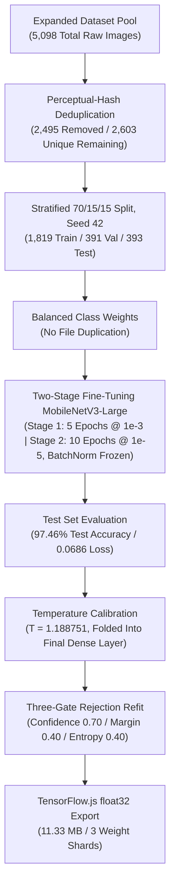

# MangoLeaf AI: Trial 3 Model Training & Performance Evaluation Report

This document records the expanded dataset pool, class-weighted two-stage fine-tuning, temperature calibration, three-gate rejection fitting, and float32 export for **Trial 3** of the on-device image classification model, completed on **August 26, 2026** and shipped to the app on **August 27, 2026**.

Notebook provenance: the clean template is `notebooks/v3/MangoLeaf_AI_Training_v3.ipynb`, the completed run with all outputs preserved is `notebooks/v3/MangoLeaf_AI_Training_v3_Post_Training.ipynb`, and the threshold refit is `notebooks/v3/MangoLeaf_AI_Threshold_Fitting_v3_Results.ipynb`. **All three were deleted from `notebooks/` before they were ever committed and must be re-downloaded from Colab.** See the notebook table in [MODEL_VERSIONING.md](../../MODEL_VERSIONING.md) for the recovery status. Every number in this report is independently sourced from `run_record.json` and from direct inspection of the shipped weight files, so no measurement depended on the lost notebooks.

Trial 3 reports **97.46%** test accuracy against Trial 2.1's **97.12%**. Those two numbers are measured on different test sets — 393 images against 417 — and must never be presented as an improvement. Trial 2.1 remains recorded in [TRIAL_v2_1.md](TRIAL_v2_1.md); this trial supersedes it as the shipping model.

---

## Development Timeline & Architecture Overview

---

## Step-by-Step Trial 3 Chronicles

### Phase 1: Perceptual-Hash Deduplication

The Trial 3 pool is a new snapshot, so deduplication was rerun from scratch with the method and threshold established in Trial 2.1 rather than re-tuned.

- **Method:** `imagehash.phash` over all 8 dihedral variants, lexicographic minimum as the canonical key.
- **Threshold:** `PHASH_DISTANCE = 5`, carried over from Trial 2.1 unchanged.
- **Scanned:** 5,098 images. **Duplicate groups:** 1,714. **Removed:** 2,495. **Unique kept:** 2,603.
- **Corrupt files:** 0.

Redundancy is 48.9%, essentially identical to Trial 2.1's 48.2%, which is expected — the same Roboflow-augmented open repositories dominate both pools.

**Two data-quality defects were carried forward, not fixed.**

| Defect                                     | Count | Status                                                                                                                                                             |
| :----------------------------------------- | :---: | :----------------------------------------------------------------------------------------------------------------------------------------------------------------- |
| Cross-label duplicate pairs                |  49   | **Not resolved.** The same image appears under two labels, so one label is wrong.                                                                                  |
| Near-duplicate pairs straddling two splits |   5   | **Not resolvable by this method.** All are cross-folder, so the two images carry different labels and per-folder deduplication cannot remove them by construction. |

Both figures are unchanged from Trial 2.1, which means the hand inspection that TRIAL_v2_1.md flagged as required before a v3 run **did not happen**. The 49 cross-label pairs are all `anthracnose` against `healthy`. They inflate test accuracy by an unmeasured amount. This is the single largest known threat to the headline number and belongs in Limitations.

### Phase 2: Stratified Split

Split 70/15/15 stratified by class, `splitSeed = 42`, `healthy_leaf` and `healthy_fruit` merged into one `healthy` class, six output classes.

| Target Disease Class       |    Train (70%)    | Validation (15%) |   Test (15%)    |   Total   |
| :------------------------- | :---------------: | :--------------: | :-------------: | :-------: |
| **`anthracnose`**          |        339        |        73        |       73        |    485    |
| **`bacterial_black_spot`** |        207        |        44        |       45        |    296    |
| **`bacterial_canker`**     |        343        |        74        |       74        |    491    |
| **`healthy`**              |        424        |        91        |       92        |    607    |
| **`mango_scab`**           |        157        |        34        |       34        |    225    |
| **`sooty_mold`**           |        349        |        75        |       75        |    499    |
| **TOTAL**                  | **1,819 (69.9%)** | **391 (15.0%)**  | **393 (15.1%)** | **2,603** |

**`mango_scab` shrank between trials, from 291 unique images to 225.** It is now the smallest class by a wide margin, its loss weight rose to 1.931, and it accounts for the weakest per-class F1 in the results below. Trial 2.1 noted that `mango_scab` and `bacterial_black_spot` were the only two classes Roboflow had never inflated, so they had nothing to lose to deduplication; a pool change that removes 66 `mango_scab` images therefore removes 66 genuinely distinct photographs. Restoring that class is the highest-value dataset action before any Trial 4.

`healthy` also fell from 714 to 607.

### Phase 3: Class Weights

`compute_class_weight('balanced')`. No files duplicated on disk.

| Class                      | Train Images | Loss Weight |
| :------------------------- | :----------: | :---------: |
| **`anthracnose`**          |     339      |   0.8943    |
| **`bacterial_black_spot`** |     207      |   1.4646    |
| **`bacterial_canker`**     |     343      |   0.8839    |
| **`healthy`**              |     424      |   0.7150    |
| **`mango_scab`**           |     157      |   1.9310    |
| **`sooty_mold`**           |     349      |   0.8687    |

Augmentation is applied live in the `tf.data` pipeline every epoch: rotation 30°, horizontal **and vertical** flip, zoom 0.2, brightness 0.2, shear 0.2. Across 15 epochs the model saw 1,819 × 15 = **27,285 augmented presentations** of 1,819 distinct images.

Note the vertical flip, which Trial 2.1 did not use. A vertically flipped leaf is a physically plausible photograph, so this is a legitimate widening of the augmentation envelope rather than label noise.

### Phase 4: Two-Stage Fine-Tuning

- **Architecture:** MobileNetV3-Large with ImageNet weights, Global Average Pooling, 20% Dropout, Dense(6) logits, Softmax. Input is raw `[0, 255]`; MobileNetV3 rescales internally, so no manual normalization exists in the notebook or the app.
- **Stage 1 (5 epochs, lr `1e-3`):** base frozen, head only.
- **Stage 2 (10 epochs, lr `1e-5`):** base unfrozen, **all BatchNormalization layers explicitly frozen**, as established in Trial 2.1.
- **Best validation loss:** `0.0982` at epoch 15, the final epoch.

Best validation loss landing on the last epoch means the model was **still improving when training stopped**. Trial 2.1 ended the same way at `0.0680`. Neither run was trained to convergence, so additional stage-2 epochs are the cheapest untested lever available.

### Phase 5: Results

- **Test accuracy:** **97.46%** (383 of 393 correct, 10 errors)
- **Test loss:** **0.0686**
- **95% Wilson score interval:** roughly **95.4% to 98.6%** on 393 images

#### Trial 3 Classification Report & F1-Scores

| Target Disease Class       | Precision | Recall | F1-Score | Test Samples |
| :------------------------- | :-------: | :----: | :------: | :----------: |
| **`anthracnose`**          |  0.9733   | 1.0000 |  0.9865  |      73      |
| **`bacterial_black_spot`** |  0.9524   | 0.8889 |  0.9195  |      45      |
| **`bacterial_canker`**     |  1.0000   | 1.0000 |  1.0000  |      74      |
| **`healthy`**              |  0.9890   | 0.9783 |  0.9836  |      92      |
| **`mango_scab`**           |  0.8649   | 0.9412 |  0.9014  |      34      |
| **`sooty_mold`**           |  1.0000   | 0.9867 |  0.9933  |      75      |
| **Macro average**          |  0.9633   | 0.9658 |  0.9641  |     393      |
| **Weighted average**       |  0.9753   | 0.9746 |  0.9746  |     393      |

#### Confusion Matrix

Rows are true labels, columns are predictions.

| True \ Predicted           | anthr. | b.b.spot | b.canker | healthy | m.scab | s.mold |
| :------------------------- | :----: | :------: | :------: | :-----: | :----: | :----: |
| **`anthracnose`**          | **73** |    0     |    0     |    0    |   0    |   0    |
| **`bacterial_black_spot`** |   0    |  **40**  |    0     |    1    |   4    |   0    |
| **`bacterial_canker`**     |   0    |    0     |  **74**  |    0    |   0    |   0    |
| **`healthy`**              |   1    |    0     |    0     | **90**  |   1    |   0    |
| **`mango_scab`**           |   0    |    2     |    0     |    0    | **32** |   0    |
| **`sooty_mold`**           |   1    |    0     |    0     |    0    |   0    | **74** |

**Six of the 10 errors are `bacterial_black_spot` confused with `mango_scab` in one direction or the other.** Four black-spot images were called scab and two scab images were called black spot. Those are the two smallest classes and the two whose folders were original field photography rather than Roboflow output. `bacterial_canker` and `anthracnose` are perfect on recall.

One `healthy` image was predicted `anthracnose`, which is the most consequential single error type in the field: it tells a grower a healthy tree is diseased. Given the 49 unresolved `anthracnose`/`healthy` cross-label pairs, that error may be a labelling artifact rather than a model failure.

### Phase 6: Temperature Calibration

A single scalar temperature was fitted on the validation set by minimizing negative log-likelihood, then **folded into the final Dense layer's weights and bias**, so the deployed graph needs no post-processing and the app applies plain softmax.

| Quantity               | Value        |
| :--------------------- | :----------- |
| Fitted temperature `T` | **1.188751** |
| Validation NLL before  | 0.098212     |
| Validation NLL after   | 0.096231     |
| Improvement            | 0.001981     |

**`T > 1` means the model was overconfident and calibration softened its probabilities.** Trial 2.1 fitted `T = 0.754966`, which is below 1 and therefore sharpened them. The two trials were miscalibrated in **opposite directions**, so no calibration behaviour carries over between them and the thresholds fitted on one set of weights are meaningless on the other.

The NLL improvement is small in absolute terms. Temperature scaling cannot reorder predictions — it is monotonic — so test accuracy is unchanged at 97.46% before and after. Its entire value is that the probability the app compares against 0.70 now means closer to what it says.

### Phase 7: Three-Gate Rejection Refit

The app rejects a scan that fails any of three gates. Out-of-scope images are photographs that are not mango leaves at all: the app must return _Uncertain_ rather than a confident disease name.

- **Out-of-scope pool:** 168 images, split 84 tune / 84 report by `np.random.RandomState(42).permutation` over one flat folder.
- **Confidence threshold:** pinned at **0.70**. This is a manuscript claim cited to [31] and was never tuned in any trial.
- **Margin** is top-1 probability minus second-place probability. **Entropy** is Shannon entropy normalized to `[0, 1]`.

#### The margin bug in the training run

The training notebook's grid search wrote **`marginThreshold: 0.0`** into `run_record.json` and into the exported `model_config.json`. A margin gate at 0.00 is vacuously true for every input, so **the margin gate rejected nothing.** Two causes compounded:

1. The sweep started at margin 0.00, which is always satisfied.
2. The candidate comparison used a strict `>`, so on a tie the **first** candidate tried won — and 0.00 was tried first.

The search was correct in the sense that 0.00 really is optimal; it is simply one of many. Refitting found **88 tied `(margin, entropy)` pairs spanning 44 distinct margins from 0.00 to 0.43**, every one of them at the same tune rejection of 0.8690. The gate's threshold was therefore free to be chosen, and the training run chose the only value that does nothing.

#### Choosing among the ties

All 88 pairs are identical on nominal metrics, so the tie was broken on robustness to the phone's 16-bit arithmetic (Phase 8). Two candidates were compared on the same test half:

|                                                      |    margin 0.43     |    **margin 0.40**     |
| :--------------------------------------------------- | :----------------: | :--------------------: |
| Retention, nominal                                   |       95.2%        |       **95.2%**        |
| Test images kept of 393                              |        374         |        **374**         |
| Tune rejection, nominal                              |       86.9%        |       **86.9%**        |
| Report rejection, nominal                            |       70.2%        |       **70.2%**        |
| Accuracy on accepted                                 |       99.20%       |       **99.20%**       |
| Retention, measured half-float band, worst case      | 94.1%, fails floor | **95.2%, holds floor** |
| Report rejection, measured band, worst case          |       67.9%        |       **67.9%**        |
| Test images within one band-width of the margin line |      4 of 393      |      **1 of 393**      |

**Margin 0.40 was selected.** The largest tied margin, 0.43, fails the 95% retention floor once the half-float band is applied, because 4 test images sit close enough to the 0.43 line to cross it. Only 1 image sits that close to 0.40. Both values are inside the tie set, so 0.40 costs nothing on any nominal metric and buys back the floor.

`0.40` is **not** provably the largest margin that holds the floor. The band-aware search maximized worst-case tune rejection first and margin second, so 0.41 and 0.42 were never tested against the floor and one of them may also hold. The claim recorded in `model_config.json` is deliberately limited to what was measured.

#### Shipped thresholds

| Gate       |  Value   | Source                             |
| :--------- | :------: | :--------------------------------- |
| Confidence | **0.70** | Fixed, cited to [31], never tuned  |
| Margin     | **0.40** | Selected among 88 ties, band-aware |
| Entropy    | **0.40** | Fitted                             |

| Metric                               | Value                                    |
| :----------------------------------- | :--------------------------------------- |
| In-distribution retention            | **95.17%** (374 of 393 test images kept) |
| Out-of-scope rejection, tune half    | **86.90%**                               |
| Out-of-scope rejection, report half  | **70.24%** (59 of 84 held-out images)    |
| 95% confidence interval on that rate | **60.5% to 80.0%**                       |
| Accuracy on accepted predictions     | **99.20%**                               |

Report the **70.24%** figure, never the 86.90% tune-half figure — the tune half is what the thresholds were fitted on. Quote it with the interval; 84 images is a small sample and the interval is 20 points wide.

Trial 2.1's comparable rejection rate was 51.19%. Trial 3's 70.24% is a large gain, but the two are measured against **different out-of-scope pools as well as different weights**, so the comparison is directional only.

**One reporting trap.** Section D of the refit cell prints a report-half nominal figure on one line and a tune-half worst-case figure on the next. The value `85.7%` appears there and is a **tune-half** number. Never quote it as a report-half rejection rate.

### Phase 8: Export and Half-Float Verification

- **Format:** TensorFlow.js Graph Model via `tf_saved_model`
- **Converter:** TensorFlow.js Converter v3.18.0, generated by TensorFlow 2.20.0
- **Quantization:** **none.** `run_record.json` records `"quantizeFloat16": false`, and the shipped `model.json` contains **zero** per-weight `quantization` blocks. Trial 2.1, by contrast, has 199 weights marked `float16`.

| File                   |          Bytes | SHA-256 (verified against `run_record.json`) |
| :--------------------- | -------------: | :------------------------------------------- |
| `group1-shard1of3.bin` |      4,194,304 | `1d9eade4…78567` match                       |
| `group1-shard2of3.bin` |      4,194,304 | `3301dcfe…be4557` match                      |
| `group1-shard3of3.bin` |      3,493,960 | `42cbb401…3d1d0` match                       |
| `model.json`           |        211,565 | `5ca24ce2…3bfe9` match                       |
| **Total**              | **12,094,133** | 11.53 MB, of which 11.33 MB is weights       |

All four checksums on the deployed files match the training run's record exactly, which proves the shipped weights are the same artifact the thresholds were fitted on. The stale `model_config.json` inside the export archive independently agrees on `temperature: 1.188751`, `temperatureFoldedIntoWeights: true`, and `trial: "3"`.

#### The download doubled, and why that is acceptable

Trial 2.1 shipped 5,941,384 bytes of float16 weights. Trial 3 ships 11,882,568 bytes of float32 weights. Halving the Trial 3 figure gives 5,941,284 — within 100 bytes of Trial 2.1. **It is the same graph at twice the precision**, so the extra 5.67 MB buys no accuracy on a phone: `src/lib/classifier.ts` sets `WEBGL_FORCE_F16_TEXTURES`, and the WebGL backend uploads every weight into a half-float texture regardless of the file's precision. The arithmetic is 16-bit either way.

The larger file is weakly better on the WASM and CPU fallback paths, where float32 weights stay float32. It is worse on first-load bandwidth. Re-exporting with `--quantize_float16` would recover the 5.67 MB and is safe, but it was judged not worth another Colab run and another provenance verification for a change that is numerically neutral on the primary target.

#### The overflow that does not reach the phone

Casting **every** Keras weight to float16 breaks this model. One tensor, `expanded_conv_depthwise_bn/moving_variance`, has a maximum absolute value of **243,318.3**, far above float16's maximum of 65,504. Cast naively it becomes `inf`, and the affected channel then emits only its beta. The training notebook's cell 32 did exactly that and printed `RuntimeWarning: overflow encountered in cast`, so its reported confidence shift of **0.042463** was measured on a **damaged** model.

That tensor does not exist in the deployed graph. `tensorflowjs_converter` folds BatchNorm statistics into the preceding convolution, and direct inspection of the three shipped shards confirms the fold:

| Check on the shipped weights                                      | Result                                                    |
| :---------------------------------------------------------------- | :-------------------------------------------------------- |
| Bytes consumed by the manifest vs. bytes in the shards            | 11,882,568 = 11,882,568, exact                            |
| Tensors in the graph                                              | 212 (199 float32, 13 int32)                               |
| Tensors exceeding the half-float maximum of 65,504                | **0**                                                     |
| Largest weight in the graph                                       | **117.53**, in `expanded_conv_7_project_bn/batchnorm/sub` |
| Headroom to the half-float ceiling                                | **557×**                                                  |
| Non-zero values below the smallest half-float normal (6.1 × 10⁻⁵) | 38,847 of ~2.97 M, about 1.3%                             |

No weight overflows on the phone. The 38,847 very small values flush toward zero in a half-float texture, which is benign — weights that small contribute negligibly to any activation.

#### Two competing band measurements

| Measurement                           | Confidence shift | Basis                                                                  |
| :------------------------------------ | :--------------: | :--------------------------------------------------------------------- |
| Refit cell 6, overflow tensor skipped |   **0.013899**   | Clean. 100.0% argmax agreement with float32, all probabilities finite. |
| Training cell 32, naive cast          |     0.042463     | Measured on a model with an `inf` channel.                             |

The ratio is 3.055×. The refit's cell 7 used that ratio as a scale factor to produce a pessimistic "scaled band", which is why a second, weaker set of figures exists:

| Band                         | Margin width | Entropy width | Retention at margin 0.40 | Report rejection |
| :--------------------------- | :----------: | :-----------: | :----------------------: | :--------------: |
| **Measured** (authoritative) |   0.029155   |   0.010755    | **95.17%, holds floor**  |      67.86%      |
| Scaled by 3.055×             |   0.089071   |   0.032858    |   93.64%, fails floor    |      61.90%      |

**The measured band is the one that describes the deployed artifact.** The scaled band calibrates against a figure obtained from a model whose overflow the converter folds away, so it is a loose upper bound rather than a measurement. Both sets are recorded in `model_config.json` under `halfFloat*` keys, with the scaled figures explicitly annotated as an upper bound.

Under the scaled band, margin 0.40 falls to 93.64% retention, below the 95% floor, and 0.43 falls there too — the scaled band is not what motivated 0.40 and switching to it gains nothing. If the scaled figures are quoted at all, quote them as a worst case that the overflow analysis shows to be unreachable.

---

## Deployment

| Artifact              | Value                                                                                 |
| :-------------------- | :------------------------------------------------------------------------------------ |
| App version           | `v0.3.0` (`package.json`)                                                             |
| Model version         | `v3.0.0` (`src/lib/constants.ts`, shown in the footer)                                |
| Config `modelVersion` | `model-v3.0.0`                                                                        |
| Runtime cache         | `mangoleaf-model-cache-v3-0-0`                                                        |
| Evicted caches        | `mangoleaf-model-cache`, `mangoleaf-model-cache-v2-1`, `mangoleaf-model-cache-v2-1-1` |

The model bump is **major** because the dataset changed, which produced a new 70/15/15 split and therefore a new test set. The app bump is **minor** because the only source changes are version strings and a cache name. The two labels are independent by design.

Build verification on August 27, 2026:

- `bun run typecheck` — clean.
- `bun run build` — compiled successfully, TypeScript clean, 4 of 4 static pages generated.
- `bun run lint` — 0 errors, 5 pre-existing unused-variable warnings, none in changed files.
- Precache manifest in the generated `public/sw.js` — all five `/model/` files present with fresh revision hashes, all three shards as `of3`, and **no** `of2` entries.
- Both stale `group1-shard1of2.bin` and `group1-shard2of2.bin` deleted from `public/model/`.
- `aiEngineDesc` in both the `en` and `bis` blocks of `src/lib/translations.ts` corrected from 98.25% to 97.46%. The About tab had been advertising Trial 2's leakage-inflated figure since before Trial 2.1 shipped, because the model-swap checklist covers the weights, the version constant, and the cache name but never mentioned the user-facing copy.

Search the minified `public/sw.js` for `'url':'` with single quotes, not `"url":`, and expect Windows backslash separators as in `/model\group1-shard1of3.bin`. A search for the forward-slash form returns nothing even when the entry is correct.

### Still outstanding

- **Phone verification on production.** Open the console on `https://mangoleaf-ai.vercel.app` and confirm `Model config loaded: margin=0.4, entropy=0.4` with neither value `null`, then photograph something that is not a mango and confirm it returns _Uncertain_. Not yet done — the deploy has not happened.
- **Accept one real `mango_scab` photograph on a production build.** It is the weakest class at 0.9014 F1, it is involved in 6 of the 10 test errors, and it lost 66 images between trials. It was already the outstanding gap after Trial 2.1.
- **Commit the four Trial 3 notebooks** as soon as they are re-downloaded from Colab.
- **Current tags.** `model-v3.0.0` and `v0.3.0` are annotated provenance tags on the finalized Trial 3 release commit.

**Release-status update, August 29, 2026.** Both annotated Trial 3 tags were created and pushed on `f73f0b8`. The subsequent `v0.4.0` application release does not alter or replace `model-v3.0.0`.

---

## Limitations

1. **49 unresolved cross-label duplicate pairs**, all `anthracnose` against `healthy`. The same image carries two different labels, so one is wrong. TRIAL_v2_1.md flagged hand inspection as required before this trial; it did not happen. Test accuracy is inflated by an unmeasured amount, and the single `healthy` → `anthracnose` error may be a labelling artifact.
2. **5 near-duplicate pairs straddle two splits.** All are cross-folder and therefore cross-label, so per-folder deduplication cannot remove them by construction.
3. **`mango_scab` has only 225 unique images**, down from 291, and 34 in the test set. Every per-class figure for it rests on 34 images and has a very wide interval.
4. **Out-of-scope rejection rests on 84 held-out images.** The 70.24% rate carries a 95% interval of 60.5% to 80.0%. The 168-image pool came from one flat folder, so it does not represent the variety of things a grower might photograph.
5. **The margin threshold was selected, not fitted.** 88 pairs tie on every nominal metric. `0.40` was chosen for half-float robustness, and is not provably the largest value that holds the retention floor — 0.41 and 0.42 were never tested.
6. **Training stopped while still improving.** Best validation loss landed on the final epoch, so the model is not trained to convergence.
7. **The download is twice the necessary size.** 11.33 MB of float32 weights where 5.94 MB of float16 would be numerically equivalent on the WebGL path.
8. **The confidence threshold of 0.70 has never been tuned** in any trial. It is carried as a citation, not as a fitted value.
9. **Test accuracy is not comparable to Trial 2.1's.** 97.46% on 393 images and 97.12% on 417 images are two different measurements, not a 0.34-point gain.
