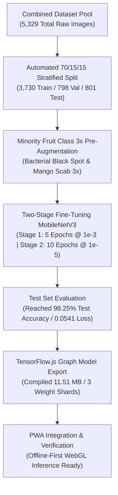

# MangoLeaf AI: Trial 2 Model Training & Performance Evaluation Report

This document records the step-by-step development, dataset pre-balancing, two-stage fine-tuning, and performance evaluation for **Trial 2** of the on-device image classification model completed on **July 25, 2026**.

---

## 📋 Development Timeline & Architecture Overview

---

## 🔍 Step-by-Step Trial 2 Chronicles

### Phase 1: Dataset Partitioning (Strict 70% / 15% / 15% Stratified Split)
* **Action:** Combined raw local field photos with open benchmark repositories (`MangoLeafBD` & `MangoDHDS`) into a unified pool of **5,329 raw images**.
* **Automated Python Split:** Utilized `scikit-learn`'s `train_test_split(test_size=0.30)` to partition the raw dataset into 3 clean, non-overlapping subsets:
  * **Training Subset (70%):** **3,730 raw images**
  * **Validation Subset (15%):** **798 raw images**
  * **Test Subset (15%):** **801 raw images** *(Held back 100% clean until final evaluation)*

#### 📊 Trial 2 Raw Dataset Distribution Matrix

| Target Disease Class | Total Raw Pool | Training Set (70%) | Validation Set (15%) | Testing Set (15%) |
| :--- | :---: | :---: | :---: | :---: |
| **`anthracnose`** | 1,177 | 824 | 176 | 177 |
| **`bacterial_canker`** | 1,194 | 836 | 179 | 179 |
| **`sooty_mold`** | 862 | 603 | 129 | 130 |
| **`healthy_leaf`** | 1,196 | 837 | 179 | 180 |
| **`bacterial_black_spot`** | 300 | 210 | 45 | 45 |
| **`mango_scab`** | 300 | 210 | 45 | 45 |
| **`healthy_fruit`** | 300 | 210 | 45 | 45 |
| **TOTAL RAW POOL** | **5,329** | **3,730 (70%)** | **798 (15%)** | **801 (15%)** |

---

### Phase 2: Minority Fruit Class 3x Pre-Augmentation
* **Action:** To prevent class imbalance bias between abundant leaf classes (~800 photos) and smaller fruit disease classes (~210 photos), a **3x pre-augmentation step** using `ImageDataGenerator.flow()` was applied to `bacterial_black_spot` and `mango_scab` training folders prior to model initialization.
* **Healthy Class Merging:** `healthy_leaf` (837 photos) and `healthy_fruit` (210 photos) were merged into a single `healthy` classification category (1,047 photos).
* **Dynamic Training Augmentation:** During the 15 training epochs, real-time spatial transformations (rotation up to 30°, zoom up to 20%, horizontal flipping) processed **46,500 total augmented exposures** in RAM.

---

### Phase 3: Two-Stage Fine-Tuning & Results
* **Setup:** Pre-trained **MobileNetV3-Large** base model loaded with ImageNet weights. Custom classification head attached with Global Average Pooling, 20% Dropout, and 6-class Softmax dense output.
* **Stage 1 (5 Epochs):** Base layers frozen (`trainable = False`). Classification head trained at learning rate `0.001` (Adam optimizer).
* **Stage 2 (10 Epochs):** Base layers unfrozen (`trainable = True`). Entire network fine-tuned at learning rate `0.00001` (`1e-5`).
* **Evaluation Score:** Reached **`98.25%` Test Accuracy** and **`0.0541` Test Loss** on the clean 15% Test Set!

#### 📋 Trial 2 Classification Report & F1-Scores

| Target Disease Class | Precision | Recall | F1-Score | Test Samples |
| :--- | :---: | :---: | :---: | :---: |
| **`anthracnose`** | **1.00** | **1.00** | **1.00** | 177 |
| **`bacterial_canker`** | **1.00** | **1.00** | **1.00** | 180 |
| **`healthy`** | **1.00** | **1.00** | **1.00** | 225 |
| **`sooty_mold`** | **1.00** | **1.00** | **1.00** | 130 |
| **`bacterial_black_spot`** | **0.88** | **0.80** | **0.84** | 45 |
| **`mango_scab`** | **0.82** | **0.89** | **0.85** | 45 |
| **OVERALL ACCURACY** | **0.98** | **0.98** | **0.98** | **802** |

---

## 📁 Final Deliverables & File Sizes

The compiled web AI engine is **11.51 MB total**, split into 3 binary weight shards for optimal HTTP parallel downloading:

| Filename | Description | File Size |
| :--- | :--- | :--- |
| **`model.json`** | Neural network topology & weight manifest | **180.87 KB** (`185,214 bytes`) |
| **`group1-shard1of3.bin`** | Primary binary weights shard | **4.00 MB** (`4,194,304 bytes`) |
| **`group1-shard2of3.bin`** | Secondary binary weights shard | **4.00 MB** (`4,194,304 bytes`) |
| **`group1-shard3of3.bin`** | Tertiary binary weights shard | **3.33 MB** (`3,493,960 bytes`) |
| **Total Size** | **Full on-device AI system** | **11.51 MB** (`12,067,782 bytes`) |

---

## 🛠️ PWA Integration & Verification

* **Service Worker Caching (`src/sw.ts`):** Serwist `CacheFirst` strategy rule pre-caches `/model/*` assets (`model.json` and all 3 `.bin` shards) for **0.0s offline launches**.
* **Singleton Model Cache (`src/lib/classifier.ts`):** Module-level `cachedModel` ensures the 11.51 MB model is loaded and GPU-warmed **only once** per browser session. Network reconnections and React remounts return the cached instance in 0.0 seconds.
* **Singleton Canvas Reuse (`src/lib/classifier.ts`):** A shared `HTMLCanvasElement` with `{ alpha: false }` context is reused across all inference calls, eliminating canvas allocation overhead.
* **Duplicate Photo Detection (`src/lib/classifier.ts`):** Native `crypto.subtle` SHA-256 binary hashing detects gallery re-uploads in 0.01s and opens existing scan reports directly without executing the AI model.
* **3G Upload Resilience (`src/hooks/useSync.ts`):** 10-second `AbortController` timeout prevents stalled 3G uploads from hanging, safely retaining pending items in IndexedDB for automatic retries. Added `isSyncingRef` lock guard to prevent concurrent sync operations from stacking.
* **WebP Storage Compression (`src/lib/classifier.ts`):** Post-diagnosis compression uses WebP at 75% quality (~75 KB, 50% smaller than JPEG) with automatic JPEG fallback for older devices.
* **React.memo Component Memoization:** `DiagnosticScanner`, `ScanCard`, `ScanHistoryList`, and `ScanDetailsModal` are wrapped in `React.memo()` to prevent unnecessary re-renders during AI scan progress updates.
* **Infinite Scroll (`src/components/ScanHistoryList.tsx`):** Replaced manual pagination button with `IntersectionObserver` auto-loading sentinel element for zero-tap scrolling.
* **Supabase Preconnect (`src/app/layout.tsx`):** Added `<link rel="preconnect">` and `<link rel="dns-prefetch">` for Supabase domain to save ~300ms DNS+TLS handshake on 3G networks.
* **PWA Viewport Export (`src/app/layout.tsx`):** Next.js 14+ `export const viewport` with theme color `#020617` matching dark UI and 5x accessibility zoom support.
* **Blob URL Auto-Revocation (`src/app/page.tsx`):** `useEffect` cleanup automatically revokes old `URL.createObjectURL()` references, preventing browser heap memory leaks during long farming sessions.
* **Batch Database Operations (`src/hooks/useSync.ts`):** Guidelines and scans are synced via `bulkPut()` single-transaction batch inserts instead of sequential individual `put()` calls.
* **Code-Splitting (`src/app/page.tsx`):** `ScanDetailsModal` and `SqlSchemaCard` are dynamically imported via `next/dynamic`, reducing initial JavaScript payload.
* **Font Optimization (`src/app/layout.tsx`):** `display: "swap"` prevents Flash of Invisible Text on slow networks.
* **Production Build Verification:** `bun run typecheck`, `bun run lint`, and `bun run build` completed with **0 errors and 0 warnings**.
* **Full optimization specifications:** See [PERFORMANCE.md](file:///C:/Users/My%20Pc/Desktop/pwa-projects/off-on-sync/PERFORMANCE.md) for the complete optimization matrix.

